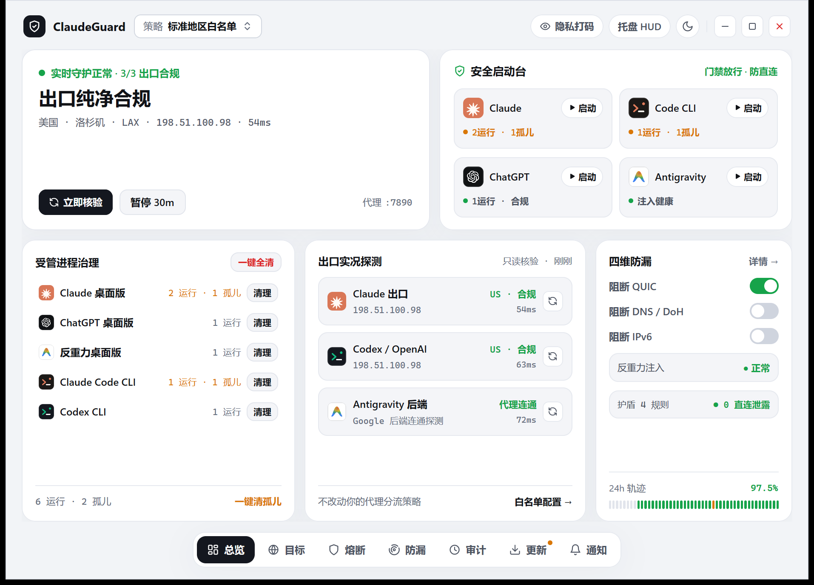
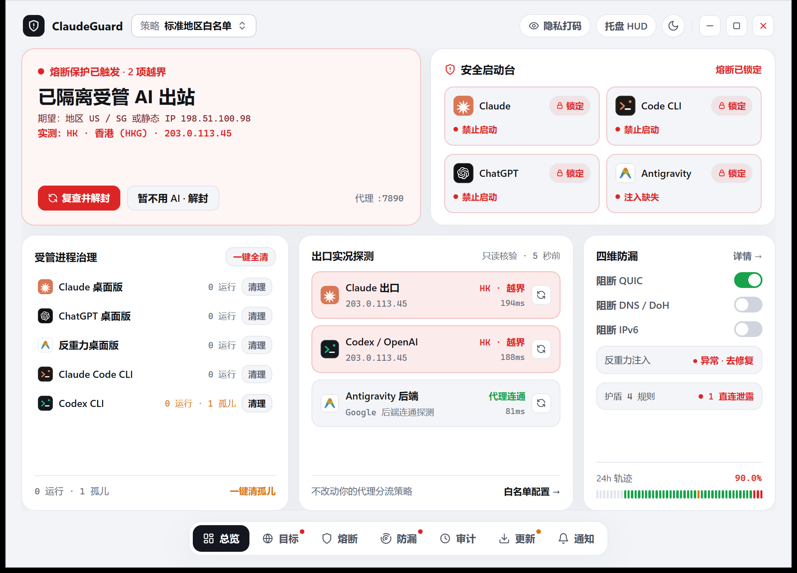
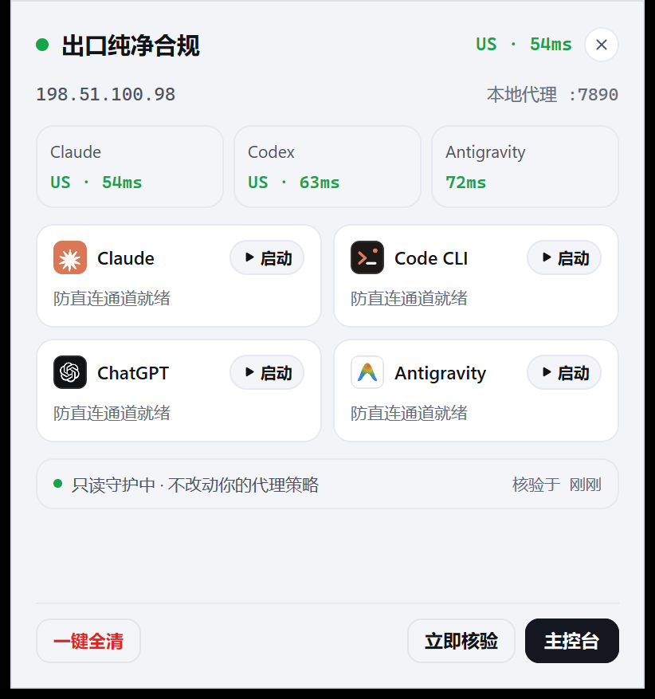
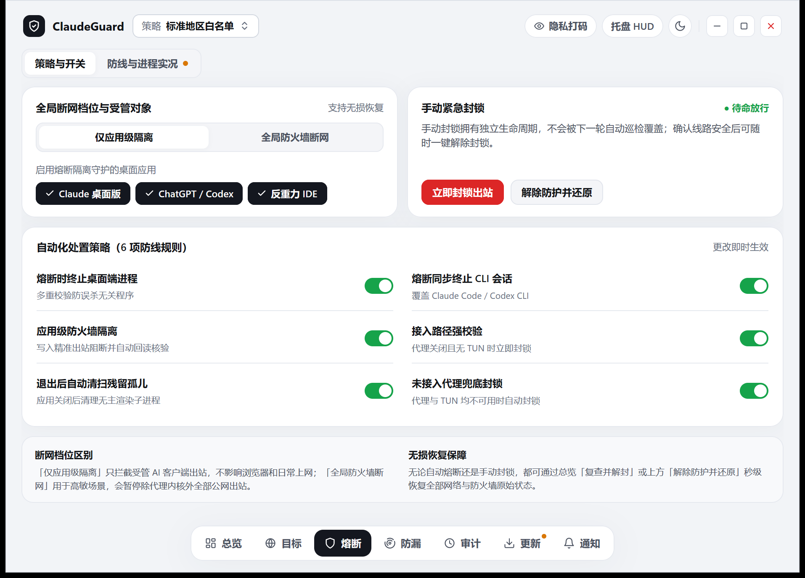
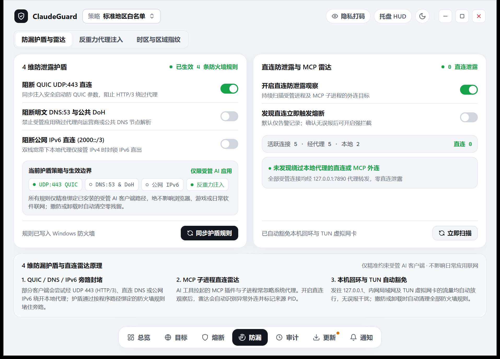
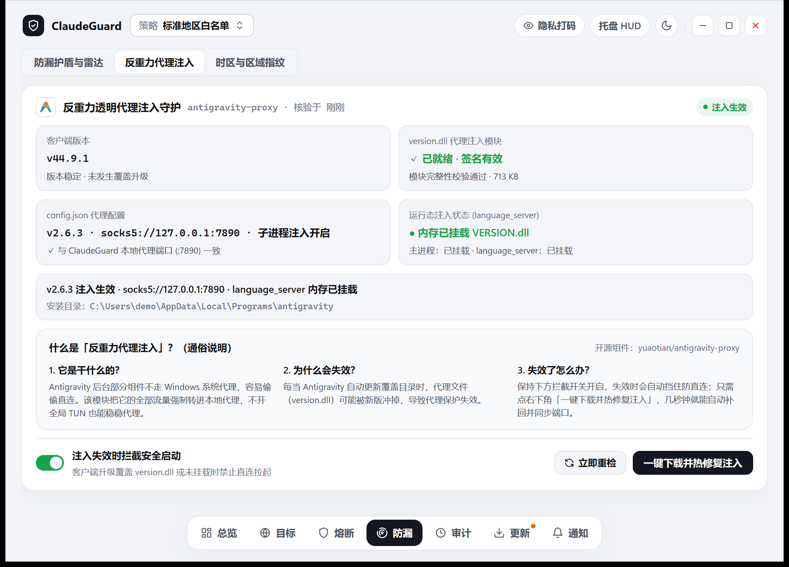
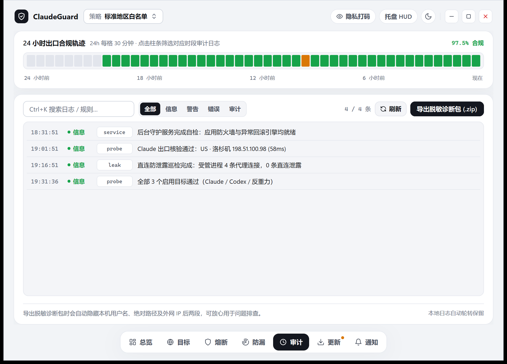
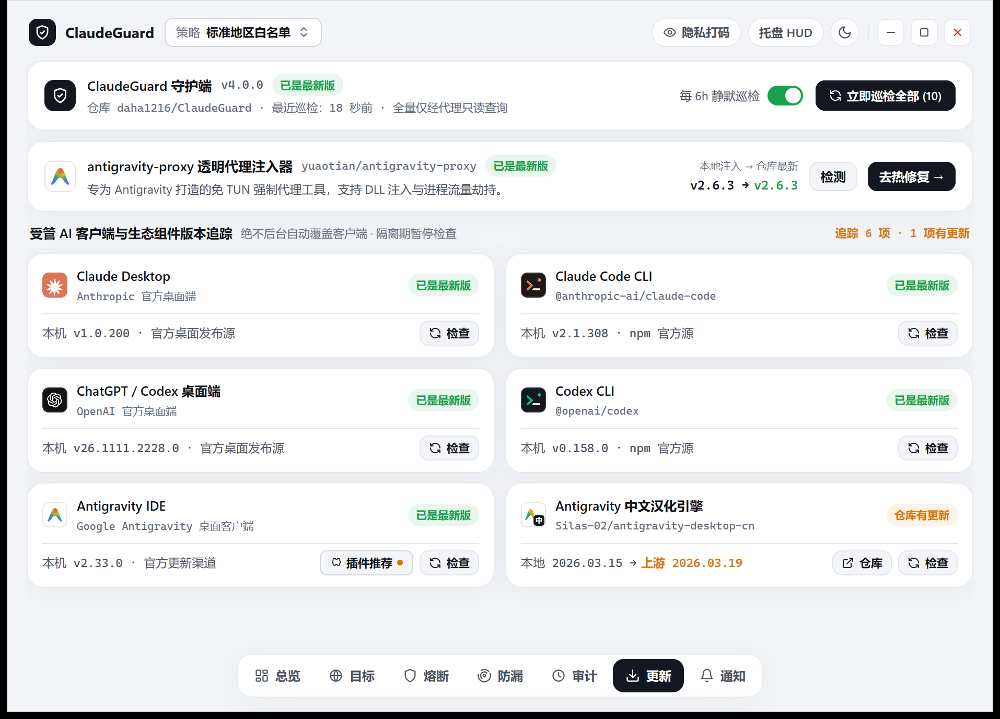
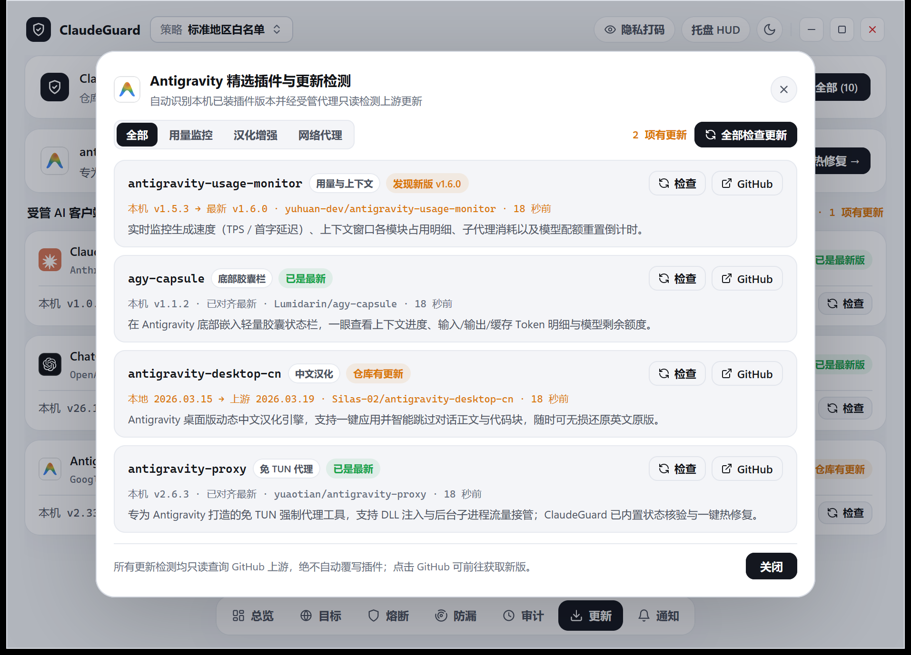
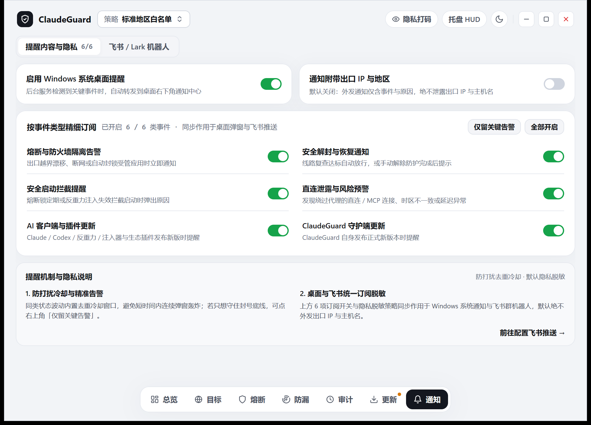

<p align="center">
  
</p>

<h1 align="center">ClaudeGuard v5</h1>

<p align="center">
  <strong>Anti-Ban Fortress: Win32 WFP kernel egress gate, 10D ban-risk radar, Sovereign Multi-Account Vaults, &lt;2ms CLI hooks &amp; native GPUI guardian for Windows AI apps and CLIs</strong>
</p>

<p align="center">
  <a href="README.md">English</a> | <a href="README.zh-CN.md">简体中文</a>
</p>

<p align="center">
  <a href="https://github.com/daha1216/ClaudeGuard/releases"></a>
  
  
  
  
  
</p>

> **Architecture note**: Built on the privilege-separated **Windows Service daemon + native GPUI client** (`claudeguard-daemon.exe` + `claudeguard-gui.exe` + `claudeguard-cli.exe`, zero WebView2 dependency, zero daily UAC prompts, crash-safe WAL rollback), **v5.0.0** expands ClaudeGuard into a full **Anti-Ban Fortress (M1–M7)** with dynamic Win32 WFP kernel filtering, a 10D ban-risk radar, Sovereign Multi-Account Vaults, encrypted 4-vector Clean-Room sanitization, `<2ms` O(1) CLI/WSL2 hook gating, and a 7-GUI + 4-CLI guarded matrix. The legacy v3 codebase remains preserved on the [`v3`](https://github.com/daha1216/ClaudeGuard/tree/v3) branch and tag [`v3.12.5`](https://github.com/daha1216/ClaudeGuard/releases/tag/v3.12.5).

---

### In One Sentence

ClaudeGuard is a **read-only, fail-closed network-egress gate for AI desktop apps on Windows**: it independently probes each target's real exit IP, region, and reachability **strictly through your configured local proxy** (never falling back to direct and never altering your proxy routing rules), blocks app launches unless all checks pass, isolates non-compliant apps via Windows Firewall + process termination + optional network cut, and restores everything deterministically via a Write-Ahead Recovery Journal (WAL).

### Why You Need It

AI desktop clients (`Claude Desktop`, `ChatGPT / Codex`, `Antigravity IDE`) and terminal agents (`Claude Code CLI`, `Codex CLI`) are sensitive to exit IP reputation and supported regions, whereas local proxy clients typically expose a single shared tunnel that can silently drift, drop into direct connection, or be bypassed via `UDP:443 QUIC`, plaintext `DNS:53 / DoH`, `IPv6`, or background helpers (e.g., Antigravity's `language_server` subprocesses and MCP child tools).

ClaudeGuard **never runs a proxy, switches nodes, or rewrites your proxy rules**. It verifies the real outbound environment *before* and *while* your AI tools talk to the network — stopping leakage before an unauthorized request ever hits the wire.

---

## Real GPUI Interface Showcase (`Frost Ceramic`)

All screenshots below are real HiDPI renders captured directly from `claudeguard-gui.exe` (rendered natively via Rust + Zed `gpui`).

### Overview & Tripped Protection (Light / Dark)

<table>
  <tr>
    <td align="center" width="50%">
      <br>
      <sub><strong>Overview · Frost Ceramic Light</strong> — Policy preset selector, Hero compliance card, 2×2 Safe Launch Deck, Process Governance, Read-Only Live Egress Telemetry &amp; 4-Vector Leak Shield</sub>
    </td>
    <td align="center" width="50%">
      <br>
      <sub><strong>Overview · Obsidian Dark</strong> — Auto-follows Windows dark preference with high-contrast dark-adapted brand icons and balanced 3-column live status</sub>
    </td>
  </tr>
  <tr>
    <td align="center" width="50%">
      <br>
      <sub><strong>Tripped &amp; Isolated State</strong> — Dual-line expected vs. observed out-of-bounds diagnosis, 2×2 Launch Deck locked, out-of-bounds probe tiles highlighted &amp; 1-click recover/disarm</sub>
    </td>
    <td align="center" width="50%">
      
      <br>
      <sub><strong>Mode A · Tray Quick HUD (398×432)</strong> — Anchored above taskbar; 3-endpoint status, inline Antigravity injection alert, 2×2 Safe Launch tiles &amp; 1-click sweep / recheck</sub>
    </td>
  </tr>
</table>

### Targets, Breaker & 4-Vector Leak Defense

<table>
  <tr>
    <td align="center" width="50%">
      <br>
      <sub><strong>Targets &amp; Policy Presets</strong> — 3-tier global policy (<code>标准地区白名单</code> / <code>严格锁定静态 IP</code> / <code>宽松防直连</code>), static IP/CIDR rules, visual 12-region picker &amp; custom targets</sub>
    </td>
    <td align="center" width="50%">
      <br>
      <sub><strong>Breaker Strategy &amp; Lockdown</strong> — App-level firewall isolation vs. global outbound cut, guarded desktop app toggles, manual emergency lockdown &amp; 6 automation switches</sub>
    </td>
  </tr>
  <tr>
    <td align="center" width="50%">
      <br>
      <sub><strong>Live Firewall &amp; Process Defense</strong> — Real-time Windows Firewall profile check, running/orphan counts &amp; active isolation rules per guarded app, 1-click orphan sweep</sub>
    </td>
    <td align="center" width="50%">
      <br>
      <sub><strong>4-Vector Leak Shield &amp; MCP Radar</strong> — Per-executable firewall blocks for <code>UDP:443 QUIC</code>, <code>DNS:53 &amp; DoH</code>, public <code>IPv6</code> &amp; Antigravity injection, plus live direct/MCP socket scan (exempts loopback &amp; TUN)</sub>
    </td>
  </tr>
</table>

### Antigravity Guardian, Environment Alignment & 24h Audit

<table>
  <tr>
    <td align="center" width="50%">
      <br>
      <sub><strong>Antigravity Proxy Guardian</strong> — Inspects <a href="https://github.com/yuaotian/antigravity-proxy">yuaotian/antigravity-proxy</a> (<code>version.dll</code> integrity, <code>config.json</code> port match, <code>language_server</code> hook), blocks launch if overwritten on update &amp; hot-repairs in 1 click</sub>
    </td>
    <td align="center" width="50%">
      <br>
      <sub><strong>Timezone &amp; Region Alignment</strong> — Aligns Windows timezone &amp; default location coordinate to your verified egress city without touching proxy nodes; backs up originals for lossless rollback</sub>
    </td>
  </tr>
  <tr>
    <td align="center" width="50%">
      <br>
      <sub><strong>Audit &amp; 24h Compliance Timeline</strong> — Interactive 48×30m bucket timeline, <code>Ctrl+K</code> instant search, level filter pills &amp; 1-click redacted <code>.zip</code> diagnostics bundle export</sub>
    </td>
    <td align="center" width="50%">
      <br>
      <sub><strong>Update Radar (10 Components)</strong> — Strictly read-only checks through local proxy for ClaudeGuard, <code>antigravity-proxy</code>, Claude/Codex Desktop &amp; CLI, Antigravity IDE &amp; <a href="https://github.com/Silas-02/antigravity-desktop-cn">antigravity-desktop-cn</a></sub>
    </td>
  </tr>
</table>

### Curated Antigravity Plugins, Desktop Toasts & Feishu Notifications

<table>
  <tr>
    <td align="center" width="50%">
      <br>
      <sub><strong>Antigravity Plugins &amp; Updates Modal</strong> — Local vs. upstream tracking for <a href="https://github.com/yuhuan-dev/antigravity-usage-monitor">antigravity-usage-monitor</a>, <a href="https://github.com/Lumidarin/agy-capsule">agy-capsule</a>, <a href="https://github.com/Silas-02/antigravity-desktop-cn">antigravity-desktop-cn</a> &amp; <a href="https://github.com/yuaotian/antigravity-proxy">antigravity-proxy</a></sub>
    </td>
    <td align="center" width="50%">
      <br>
      <sub><strong>Desktop &amp; Alert Preferences</strong> — 6 event toggles, 1-click critical-only preset, privacy-by-default egress IP/hostname redaction &amp; Session-0 → Session-1 native Windows toast relay</sub>
    </td>
  </tr>
</table>

<p align="center">
  <br>
  <sub><strong>Feishu / Lark Bot</strong> — HMAC-SHA256 signature verification, Windows <code>DPAPI</code> credential encryption, persistent offline retry queue &amp; redacted test delivery</sub>
</p>

---

## v5 Architecture & Anti-Ban Fortress Highlights (M1–M7)

1. **Privilege-Separated 3-Binary Design & Hardened Named Pipe IPC (`\\.\pipe\ClaudeGuardV4`)**:
   - **`claudeguard-daemon.exe`** (`ClaudeGuardService`, Windows `LocalSystem`): owns WFP/COM firewall rules, process governance, OS timezone/location alignment, `antigravity-proxy` injection checks, proxy-only probing, Sovereign Vaults, Clean-Room encryption, and WAL recovery.
   - **`claudeguard-gui.exe`** (`asInvoker`, normal user token): native GPUI interface with zero WebView2 overhead, native Win32 `RegisterHotKey` panic-lockdown & quick-HUD chords (zero `SetWindowsHookEx`), zero-IP-leak Markdown/PNG Health Card export, and ~0 VRAM in `--tray` mode.
   - **`claudeguard-cli.exe`**: `<2ms` O(1) `--hook-gate`, `--launch-vault` / `vault launch`, `--cleanroom-scan`, `--check`, `--status`, and `--restore` (including offline WAL + persistent WFP recovery).
2. **M1 · Dynamic Win32 WFP Kernel Filtering + Live Blocked-Packet Waterfall**:
   - `AutoWfpFirst` hybrid engine (`FWPM_SESSION_DYNAMIC` sublayer `0xFF00` that auto-clears if the daemon stops, opt-in `wfp_boot_guard: false` persistent `FWPM_FILTER_FLAG_BOOTTIME` sublayer `0xFF10` with separated provider GUIDs, plus COM fallback) and live `FwpmNetEventSubscribe4` blocked-event waterfall with IP privacy masking.
3. **M2 & M3 · 10D Ban-Risk Radar, 290+ Offline ASN DB, 7-Day Geo-Velocity Ledger, STUN & Electron Hygiene**:
   - Deterministic 0–100 (`S`–`D`) ban-risk scoring backed by a 290+ entry offline ASN classification table and a DPAPI-HMAC-SHA256 7-day rolling geo-velocity ledger (`egress_history.json`, zero plaintext IPs on disk).
   - Native RFC 5389 STUN UDP/WebRTC leak detection plus `NtQueryInformationProcess(60)` Electron/Chromium proxy-flag hygiene auditing and WAL-protected shortcut cleanup.
4. **M4 & M5 · Sovereign Multi-Account Vaults & 4-Vector Clean-Room Sanitizer (`CGBAK005`)**:
   - Per-account isolated profile directories (`--user-data-dir` / `CLAUDE_CONFIG_DIR`), per-vault egress baselines, desktop `.lnk` launchers, and read-only fail-closed launch enforcement (`auto_align_mihomo_on_vault_launch: false` by default).
   - 4-vector local residue scanner that preserves 100% of user code/configs and mandates `CGBAK005` Windows CNG AES-256-GCM + DPAPI encrypted `.cgbak` Time-Machine backups before any purge.
5. **M6 & M7 · `<2ms` O(1) CLI Hooks, WSL2 Loopback HMAC Bridge, `BurstGuard` & 7-GUI + 4-CLI Matrix**:
   - Idempotent Claude Code `settings.json` hook merge and PowerShell `$PROFILE` wrapper installer, loopback-only (`127.0.0.1:0`) WSL2 HMAC-SHA256 anti-replay bridge (`.claudeguard-wsl-token`), and `BurstGuard` rate/cadence anomaly defense.
   - Expanded coverage across **7 GUI apps** (`Claude Desktop`, `ChatGPT / Codex`, `Antigravity IDE`, `Cursor`, `Windsurf`, `Zed`, `Trae`) and **4 CLIs** (`Claude Code`, `Codex CLI`, `Gemini CLI`, `Aider CLI`), alongside the 10-component read-only update radar.

---

## Install & Quick Start (Windows 10 / 11 x64)

Grab the latest release from [GitHub Releases](https://github.com/daha1216/ClaudeGuard/releases):

1. **Installer — `ClaudeGuard-v5.0.0-setup.exe` (Recommended)**
   - Registers & starts `ClaudeGuardService` (`LocalSystem`, auto-start at boot) and adds normal-privilege tray autostart (`claudeguard-gui.exe --tray`) so daily usage requires **0 UAC prompts**.
   - Upgrading from v3 or v4 (`v3.x` / `v4.x`): shares the same Inno Setup `AppId`, gracefully stops running service/tray processes, cleans up legacy v3 `HKCU\...\Run\ClaudeGuard`, and automatically migrates existing `config.json` (preserving backups).
   - Uninstall runs `claudeguard-cli.exe --restore` to clear firewall/WFP rules before removing the Windows Service & binaries, while deliberately preserving configuration and journals in `%ProgramData%\ClaudeGuard` and `%APPDATA%\ClaudeGuard`.
2. **In-App Upgrade Bridge — `ClaudeGuard-v5.0.0-upgrade.exe` (For `v3.x` Auto-Update)**
   - Matched automatically by legacy `v3.x` clients during 6-hour background checks and manual "Check for updates": copies `%APPDATA%\ClaudeGuard\config.json` into `%ProgramData%\ClaudeGuard\config.json`, stages and launches the v5 installer cleanly, waits for completion, and removes legacy `ClaudeGuard.exe`, shortcuts, and staging residue after installation succeeds.
3. **Portable — `ClaudeGuard-v5.0.0-portable.zip`**
   - Contains `claudeguard-daemon.exe`, `claudeguard-cli.exe`, and `claudeguard-gui.exe`. Run `claudeguard-daemon.exe --console` (elevated) or register the service via `--install-service --start`, then launch `claudeguard-gui.exe` as your normal user.

> Verify integrity anytime against the release `SHA256SUMS.txt`.

---

## CLI & GUI Flags

### `claudeguard-cli.exe` (Sub-2ms Hook Gate, Vaults, Clean-Room & Emergency)

```powershell
claudeguard-cli.exe --hook-gate --agent claude-code        # <2ms O(1) pre-prompt gate (Claude Code hook JSON or --exit-code-block)
claudeguard-cli.exe vault launch --vault <ID> --app <APP>  # Safe-launch an app inside a Sovereign Account Vault
claudeguard-cli.exe --cleanroom-scan                       # 100% read-only 4-vector local Clean-Room residue scan
claudeguard-cli.exe --check                                # Query daemon compliance JSON; exit 0=pass, 2=not passed
claudeguard-cli.exe --check --recheck                      # Trigger fresh probe round first, then print compliance JSON
claudeguard-cli.exe --restore                              # Emergency disarm & full firewall/WFP/network/env restore (online or offline WAL)
claudeguard-cli.exe --status                               # Print daemon service, WAL journal & live snapshot status JSON
```

### `claudeguard-daemon.exe`

```powershell
claudeguard-daemon.exe --install-service --start   # Register & start LocalSystem ClaudeGuardService
claudeguard-daemon.exe --uninstall-service         # Stop & unregister Windows Service
claudeguard-daemon.exe --service-status            # Query SCM status JSON
claudeguard-daemon.exe --console                   # Run in foreground console mode (development/portable)
```

### `claudeguard-gui.exe`

```powershell
claudeguard-gui.exe                                # Open Mode B Console (normal user privilege)
claudeguard-gui.exe --tray                         # Start resident in system tray (0 windows, 0 VRAM)
claudeguard-gui.exe --hud                          # Open Mode A compact Tray Quick HUD (398x432)
claudeguard-gui.exe --demo pass                    # Standalone UI demo (pass | trip | disarmed | wizard), zero daemon needed
```

---

## Data & Privacy

- Primary daemon state lives in `%ProgramData%\ClaudeGuard\` (cascading to `%APPDATA%\ClaudeGuard\` → `%LOCALAPPDATA%\ClaudeGuard\`):
  - `config.json`: v4 configuration (auto-migrated cleanly from v2/v3 with `config.v{ver}.bak.json` preserved).
  - `journal.json`: crash-safe WAL recovery journal for idempotent startup/offline rollback.
  - `feishu.json`: Windows `DPAPI` (`LocalMachine`) encrypted Webhook URL & signing secret, plus offline retry queue.
  - `env_backup.json`: pre-alignment snapshot of original Windows timezone & default location coordinates.
- Privacy defaults:
  - Outbound desktop & Feishu alerts redact egress IP & hostname by default (`include_egress: false`).
  - One-click `.zip` diagnostic bundle export (`Audit` tab) automatically strips usernames, local absolute paths, and the last two IPv4 octets.
  - **Zero third-party telemetry** and **zero direct fallback probing** when proxy access is unavailable.

---

## Build from Source

Requires Rust (`1.98+`, verified on `rustc 1.99.0`), Windows 10/11 SDK, and [Inno Setup 6](https://jrsoftware.org/isinfo.php) (for `.exe` installer packaging):

```powershell
# 1. Core workspace (protocol, core, platform, daemon, cli) — 330 tests
cargo clippy --workspace --all-targets -- -D warnings
cargo test --workspace --locked

# 2. v3->v5 upgrade bridge (cg-v3-bridge) — 4 tests
cargo clippy --locked --manifest-path crates/cg-v3-bridge/Cargo.toml --all-targets -- -D warnings
cargo test --locked --manifest-path crates/cg-v3-bridge/Cargo.toml

# 3. Native GPUI desktop client (cg-gui) — 71 tests (incl. live daemon pipe E2E)
cargo clippy --locked --manifest-path crates/cg-gui/Cargo.toml --all-targets -- -D warnings
cargo test --locked --manifest-path crates/cg-gui/Cargo.toml

# 4. Stage Release binaries, Inno Setup installer, portable zip & SHA256SUMS.txt
pwsh -NoProfile -ExecutionPolicy Bypass -File make-release.ps1
```

See [CONTRIBUTING.md](CONTRIBUTING.md), [CHANGELOG.md](CHANGELOG.md), and [SECURITY.md](SECURITY.md) for engineering conventions and test fixture rules.

---

## License

- Core engine, daemon, CLI & Windows platform layer (`cg-protocol`, `cg-core`, `cg-platform`, `cg-daemon`): [MIT](LICENSE) © 2026 daha1216
- Native GPUI desktop interface (`crates/cg-gui`): Apache-2.0
