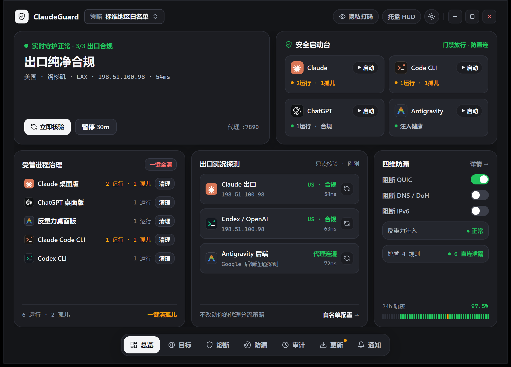
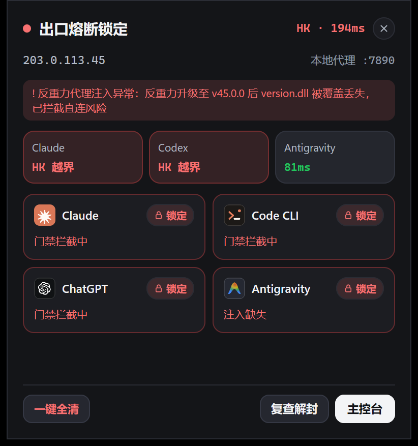
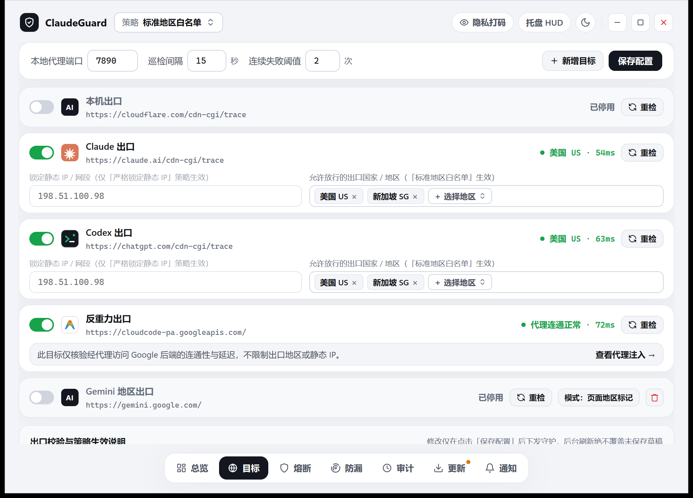
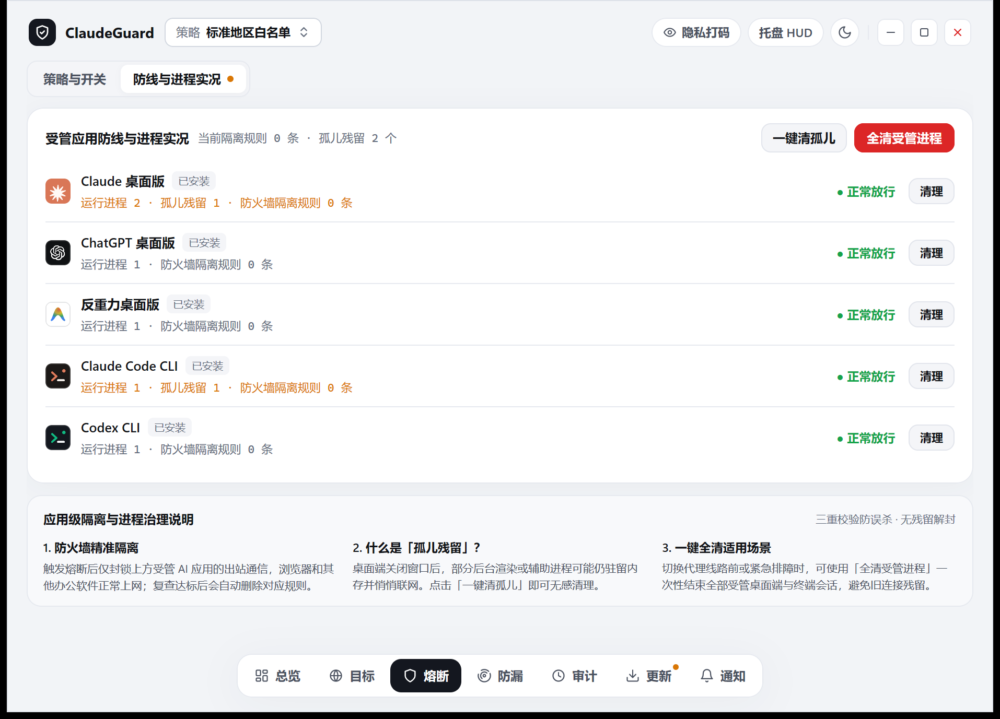
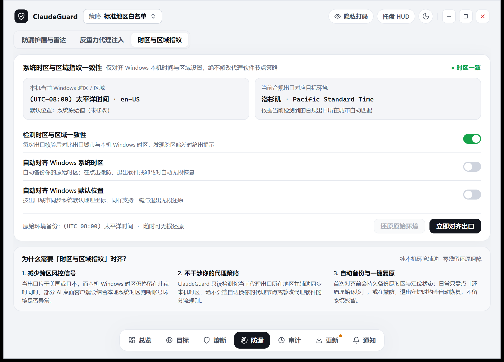
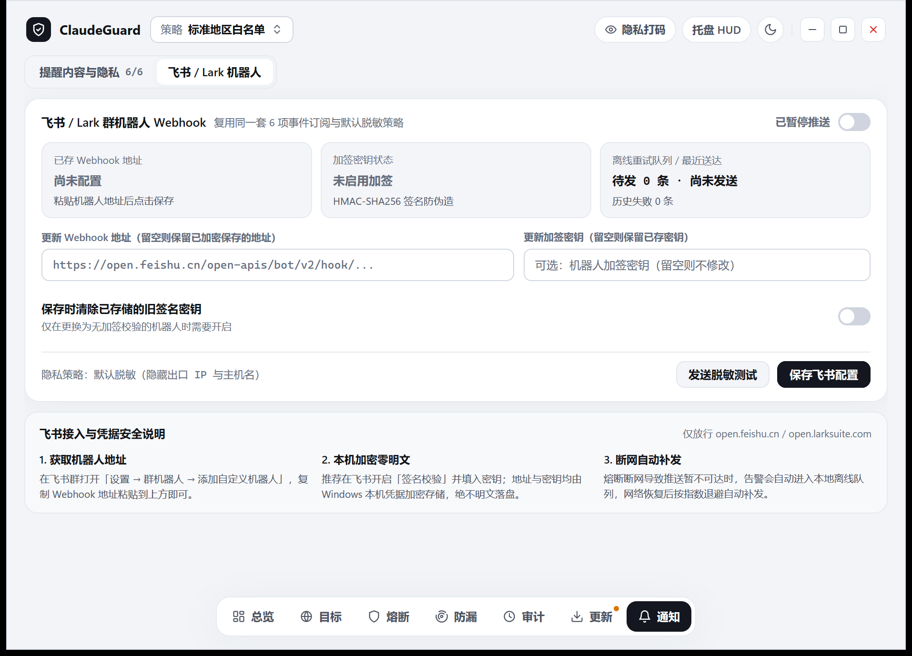

<p align="center">
  
</p>

<h1 align="center">ClaudeGuard v4</h1>

<p align="center">
  <strong>Zero-bypass Windows Service egress gate &amp; native GPUI desktop guardian for AI desktop apps and CLIs</strong>
</p>

<p align="center">
  <a href="README.md">English</a> | <a href="README.zh-CN.md">简体中文</a>
</p>

<p align="center">
  <a href="https://github.com/daha1216/ClaudeGuard/releases"></a>
  
  
  
  
</p>

> **Architecture note**: Starting from **v4.0.0**, ClaudeGuard has been rebuilt from a Tauri 2 single binary into a **Windows Service daemon + native GPUI client** (`claudeguard-daemon.exe` + `claudeguard-gui.exe` + `claudeguard-cli.exe`) — **zero WebView2 dependency, zero daily UAC prompts**, and crash-safe WAL rollback. The legacy v3 codebase (including the community macOS preview) remains preserved on the [`v3`](https://github.com/daha1216/ClaudeGuard/tree/v3) branch and tag [`v3.12.5`](https://github.com/daha1216/ClaudeGuard/releases/tag/v3.12.5).

---

### In One Sentence

ClaudeGuard is a **read-only, fail-closed network-egress gate for AI desktop apps on Windows**: it independently probes each target's real exit IP, region, and reachability **strictly through your configured local proxy** (never falling back to direct and never altering your proxy routing rules), blocks app launches unless all checks pass, isolates non-compliant apps via Windows Firewall + process termination + optional network cut, and restores everything deterministically via a Write-Ahead Recovery Journal (WAL).

### Why You Need It

AI desktop clients (`Claude Desktop`, `ChatGPT / Codex`, `Antigravity IDE`) and terminal agents (`Claude Code CLI`, `Codex CLI`) are sensitive to exit IP reputation and supported regions, whereas local proxy clients typically expose a single shared tunnel that can silently drift, drop into direct connection, or be bypassed via `UDP:443 QUIC`, plaintext `DNS:53 / DoH`, `IPv6`, or background helpers (e.g., Antigravity's `language_server` subprocesses and MCP child tools).

ClaudeGuard **never runs a proxy, switches nodes, or rewrites your proxy rules**. It verifies the real outbound environment *before* and *while* your AI tools talk to the network — stopping leakage before an unauthorized request ever hits the wire.

---

## Real GPUI Interface Showcase (`Frost Ceramic`)

All screenshots below are real HiDPI renders captured directly from `claudeguard-gui.exe` (rendered natively via Rust + Zed `gpui`).

### Overview & Tripped Protection (Light / Dark)

<table>
  <tr>
    <td align="center" width="50%">
      <br>
      <sub><strong>Overview · Frost Ceramic Light</strong> — Policy preset selector, Hero compliance card, 2×2 Safe Launch Deck, Process Governance, Read-Only Live Egress Telemetry &amp; 4-Vector Leak Shield</sub>
    </td>
    <td align="center" width="50%">
      <br>
      <sub><strong>Overview · Obsidian Dark</strong> — Auto-follows Windows dark preference with high-contrast dark-adapted brand icons and balanced 3-column live status</sub>
    </td>
  </tr>
  <tr>
    <td align="center" width="50%">
      <br>
      <sub><strong>Tripped &amp; Isolated State</strong> — Dual-line expected vs. observed out-of-bounds diagnosis, 2×2 Launch Deck locked, out-of-bounds probe tiles highlighted &amp; 1-click recover/disarm</sub>
    </td>
    <td align="center" width="50%">
      
      <br>
      <sub><strong>Mode A · Tray Quick HUD (398×432)</strong> — Anchored above taskbar; 3-endpoint status, inline Antigravity injection alert, 2×2 Safe Launch tiles &amp; 1-click sweep / recheck</sub>
    </td>
  </tr>
</table>

### Targets, Breaker & 4-Vector Leak Defense

<table>
  <tr>
    <td align="center" width="50%">
      <br>
      <sub><strong>Targets &amp; Policy Presets</strong> — 3-tier global policy (<code>标准地区白名单</code> / <code>严格锁定静态 IP</code> / <code>宽松防直连</code>), static IP/CIDR rules, visual 12-region picker &amp; custom targets</sub>
    </td>
    <td align="center" width="50%">
      <br>
      <sub><strong>Breaker Strategy &amp; Lockdown</strong> — App-level firewall isolation vs. global outbound cut, guarded desktop app toggles, manual emergency lockdown &amp; 6 automation switches</sub>
    </td>
  </tr>
  <tr>
    <td align="center" width="50%">
      <br>
      <sub><strong>Live Firewall &amp; Process Defense</strong> — Real-time Windows Firewall profile check, running/orphan counts &amp; active isolation rules per guarded app, 1-click orphan sweep</sub>
    </td>
    <td align="center" width="50%">
      <br>
      <sub><strong>4-Vector Leak Shield &amp; MCP Radar</strong> — Per-executable firewall blocks for <code>UDP:443 QUIC</code>, <code>DNS:53 &amp; DoH</code>, public <code>IPv6</code> &amp; Antigravity injection, plus live direct/MCP socket scan (exempts loopback &amp; TUN)</sub>
    </td>
  </tr>
</table>

### Antigravity Guardian, Environment Alignment & 24h Audit

<table>
  <tr>
    <td align="center" width="50%">
      <br>
      <sub><strong>Antigravity Proxy Guardian</strong> — Inspects <a href="https://github.com/yuaotian/antigravity-proxy">yuaotian/antigravity-proxy</a> (<code>version.dll</code> integrity, <code>config.json</code> port match, <code>language_server</code> hook), blocks launch if overwritten on update &amp; hot-repairs in 1 click</sub>
    </td>
    <td align="center" width="50%">
      <br>
      <sub><strong>Timezone &amp; Region Alignment</strong> — Aligns Windows timezone &amp; default location coordinate to your verified egress city without touching proxy nodes; backs up originals for lossless rollback</sub>
    </td>
  </tr>
  <tr>
    <td align="center" width="50%">
      <br>
      <sub><strong>Audit &amp; 24h Compliance Timeline</strong> — Interactive 48×30m bucket timeline, <code>Ctrl+K</code> instant search, level filter pills &amp; 1-click redacted <code>.zip</code> diagnostics bundle export</sub>
    </td>
    <td align="center" width="50%">
      <br>
      <sub><strong>Update Radar (10 Components)</strong> — Strictly read-only checks through local proxy for ClaudeGuard, <code>antigravity-proxy</code>, Claude/Codex Desktop &amp; CLI, Antigravity IDE &amp; <a href="https://github.com/Silas-02/antigravity-desktop-cn">antigravity-desktop-cn</a></sub>
    </td>
  </tr>
</table>

### Curated Antigravity Plugins, Desktop Toasts & Feishu Notifications

<table>
  <tr>
    <td align="center" width="50%">
      <br>
      <sub><strong>Antigravity Plugins &amp; Updates Modal</strong> — Local vs. upstream tracking for <a href="https://github.com/yuhuan-dev/antigravity-usage-monitor">antigravity-usage-monitor</a>, <a href="https://github.com/Lumidarin/agy-capsule">agy-capsule</a>, <a href="https://github.com/Silas-02/antigravity-desktop-cn">antigravity-desktop-cn</a> &amp; <a href="https://github.com/yuaotian/antigravity-proxy">antigravity-proxy</a></sub>
    </td>
    <td align="center" width="50%">
      <br>
      <sub><strong>Desktop &amp; Alert Preferences</strong> — 6 event toggles, 1-click critical-only preset, privacy-by-default egress IP/hostname redaction &amp; Session-0 → Session-1 native Windows toast relay</sub>
    </td>
  </tr>
</table>

<p align="center">
  <br>
  <sub><strong>Feishu / Lark Bot</strong> — HMAC-SHA256 signature verification, Windows <code>DPAPI</code> credential encryption, persistent offline retry queue &amp; redacted test delivery</sub>
</p>

---

## v4 Architecture Highlights

1. **Privilege-Separated 3-Binary Design**:
   - **`claudeguard-daemon.exe`** (`ClaudeGuardService`, Windows `LocalSystem`): owns firewall COM rules, process termination/orphan cleanup, OS timezone/location writes, `antigravity-proxy` injection checks, proxy-only probing, and WAL recovery. Starts automatically at boot.
   - **`claudeguard-gui.exe`** (`asInvoker`, normal user token): native GPUI interface with zero WebView2 overhead, spawning guarded AI apps with the user's normal desktop token, relaying desktop toasts in Session-1, and idling at ~0 VRAM in `--tray` mode.
   - **`claudeguard-cli.exe`**: scriptable `--check` pre-flight check, `--status` diagnostics, and `--restore` emergency recovery (with offline WAL fallback if the service is stopped).
2. **Hardened Named Pipe IPC (`\\.\pipe\ClaudeGuardV4`)**:
   - Secured via SDDL ACL (`D:(A;;GA;;;SY)(A;;GA;;;BA)(A;;GRGW;;;AU)`) + `PIPE_REJECT_REMOTE_CLIENTS` (blocks remote SMB access, lets normal interactive users talk to Session-0 without daily UAC prompts).
3. **Write-Ahead Recovery Journal (`journal.json`)**:
   - Every OS mutation (per-app firewall block, manual lockdown, global outbound cut, NIC disable, OS timezone/location alignment) persists and flushes a WAL transaction *before* changing Windows state. Startup self-healing and `--restore` execute deterministic, verified idempotent cleanup (`list_managed_firewall_rules == 0`).
4. **Proxy-Only Egress Probing (Zero Direct Fallback)**:
   - Every target binds its own domain: `Claude` → `claude.ai/cdn-cgi/trace`, `Codex` → `chatgpt.com/cdn-cgi/trace`, `Antigravity` → reachability of `daily-cloudcode-pa.googleapis.com` (`cloudcode-pa.googleapis.com`), `Local Egress` (off by default) → `cloudflare.com/cdn-cgi/trace`, plus custom HTTP trace / JSON IP / page region / reachability targets.
   - All probes and update checks strictly obey `ProbeRoute` (configured proxy or verified TUN); if no proxy access exists, ClaudeGuard **never probes direct** with your home IP.
5. **10-Component Read-Only Update Radar**:
   - Tracks `ClaudeGuard` (`daha1216/ClaudeGuard`), `antigravity-proxy` (`yuaotian/antigravity-proxy`), `Claude Desktop` (MSIX), `Claude Code CLI` (npm), `ChatGPT / Codex Desktop` (MSIX), `Codex CLI` (npm), `Antigravity IDE` (`latest-x64-win.yml`), `Antigravity 中文汉化引擎` (`Silas-02/antigravity-desktop-cn`), `antigravity-usage-monitor` (`yuhuan-dev/antigravity-usage-monitor`), and `agy-capsule` (`Lumidarin/agy-capsule`). Read-only checks only — never auto-overwrites installed clients or plugins.

---

## Install & Quick Start (Windows 10 / 11 x64)

Grab the latest release from [GitHub Releases](https://github.com/daha1216/ClaudeGuard/releases):

1. **Installer — `ClaudeGuard-v4.0.1-setup.exe` (Recommended)**
   - Registers & starts `ClaudeGuardService` (`LocalSystem`, auto-start at boot) and adds normal-privilege tray autostart (`claudeguard-gui.exe --tray`) so daily usage requires **0 UAC prompts**.
   - Upgrading from v3 (`v3.x`): shares the same Inno Setup `AppId`, gracefully stops `ClaudeGuard.exe`, cleans up the legacy v3 `HKCU\...\Run\ClaudeGuard` entry, and automatically migrates legacy `config.json` (writing a one-time `config.v3.bak.json` backup).
   - Uninstall cleanly removes the Windows Service & binaries while deliberately preserving configuration and journals in `%ProgramData%\ClaudeGuard` and `%APPDATA%\ClaudeGuard`.
2. **In-App Upgrade Bridge — `ClaudeGuard-v4.0.1-upgrade.exe` (For `v3.x` Auto-Update)**
   - Matched automatically by legacy `v3.x` clients during 6-hour background checks and manual "Check for updates": copies `%APPDATA%\ClaudeGuard\config.json` into `%ProgramData%\ClaudeGuard\config.json`, stages and launches the v4 installer cleanly, waits for completion, and removes legacy `ClaudeGuard.exe`, shortcuts, and staging residue after installation succeeds.
3. **Portable — `ClaudeGuard-v4.0.1-portable.zip`**
   - Contains `claudeguard-daemon.exe`, `claudeguard-cli.exe`, and `claudeguard-gui.exe`. Run `claudeguard-daemon.exe --console` (elevated) or register the service via `--install-service --start`, then launch `claudeguard-gui.exe` as your normal user.

> Verify integrity anytime against the release `SHA256SUMS.txt`.

---

## CLI & GUI Flags

### `claudeguard-cli.exe` (Scriptable & Emergency)

```powershell
claudeguard-cli.exe --check              # Query daemon compliance JSON; exit 0=pass, 2=not passed
claudeguard-cli.exe --check --recheck    # Trigger fresh probe round first, then print compliance JSON
claudeguard-cli.exe --restore            # Emergency disarm & full firewall/network/env restore (online or offline WAL fallback)
claudeguard-cli.exe --status             # Print daemon service, WAL journal & live snapshot status JSON
```

### `claudeguard-daemon.exe`

```powershell
claudeguard-daemon.exe --install-service --start   # Register & start LocalSystem ClaudeGuardService
claudeguard-daemon.exe --uninstall-service         # Stop & unregister Windows Service
claudeguard-daemon.exe --service-status            # Query SCM status JSON
claudeguard-daemon.exe --console                   # Run in foreground console mode (development/portable)
```

### `claudeguard-gui.exe`

```powershell
claudeguard-gui.exe                                # Open Mode B Console (normal user privilege)
claudeguard-gui.exe --tray                         # Start resident in system tray (0 windows, 0 VRAM)
claudeguard-gui.exe --hud                          # Open Mode A compact Tray Quick HUD (398x432)
claudeguard-gui.exe --demo pass                    # Standalone UI demo (pass | trip | disarmed | wizard), zero daemon needed
```

---

## Data & Privacy

- Primary daemon state lives in `%ProgramData%\ClaudeGuard\` (cascading to `%APPDATA%\ClaudeGuard\` → `%LOCALAPPDATA%\ClaudeGuard\`):
  - `config.json`: v4 configuration (auto-migrated cleanly from v2/v3 with `config.v{ver}.bak.json` preserved).
  - `journal.json`: crash-safe WAL recovery journal for idempotent startup/offline rollback.
  - `feishu.json`: Windows `DPAPI` (`LocalMachine`) encrypted Webhook URL & signing secret, plus offline retry queue.
  - `env_backup.json`: pre-alignment snapshot of original Windows timezone & default location coordinates.
- Privacy defaults:
  - Outbound desktop & Feishu alerts redact egress IP & hostname by default (`include_egress: false`).
  - One-click `.zip` diagnostic bundle export (`Audit` tab) automatically strips usernames, local absolute paths, and the last two IPv4 octets.
  - **Zero third-party telemetry** and **zero direct fallback probing** when proxy access is unavailable.

---

## Build from Source

Requires Rust (`1.98+`, verified on `rustc 1.99.0`), Windows 10/11 SDK, and [Inno Setup 6](https://jrsoftware.org/isinfo.php) (for `.exe` installer packaging):

```powershell
# 1. Core workspace (protocol, core, platform, daemon, cli) — 188 tests
cargo clippy --workspace --all-targets -- -D warnings
cargo test --workspace --locked

# 2. Native GPUI desktop client (cg-gui) — 25 tests (incl. live daemon pipe E2E)
cargo clippy --locked --manifest-path crates/cg-gui/Cargo.toml --all-targets -- -D warnings
cargo test --locked --manifest-path crates/cg-gui/Cargo.toml

# 3. Stage Release binaries, Inno Setup installer, portable zip & SHA256SUMS.txt
pwsh -NoProfile -ExecutionPolicy Bypass -File make-release.ps1
```

See [CONTRIBUTING.md](CONTRIBUTING.md), [CHANGELOG.md](CHANGELOG.md), and [SECURITY.md](SECURITY.md) for engineering conventions and test fixture rules.

---

## License

- Core engine, daemon, CLI & Windows platform layer (`cg-protocol`, `cg-core`, `cg-platform`, `cg-daemon`): [MIT](LICENSE) © 2026 daha1216
- Native GPUI desktop interface (`crates/cg-gui`): Apache-2.0
