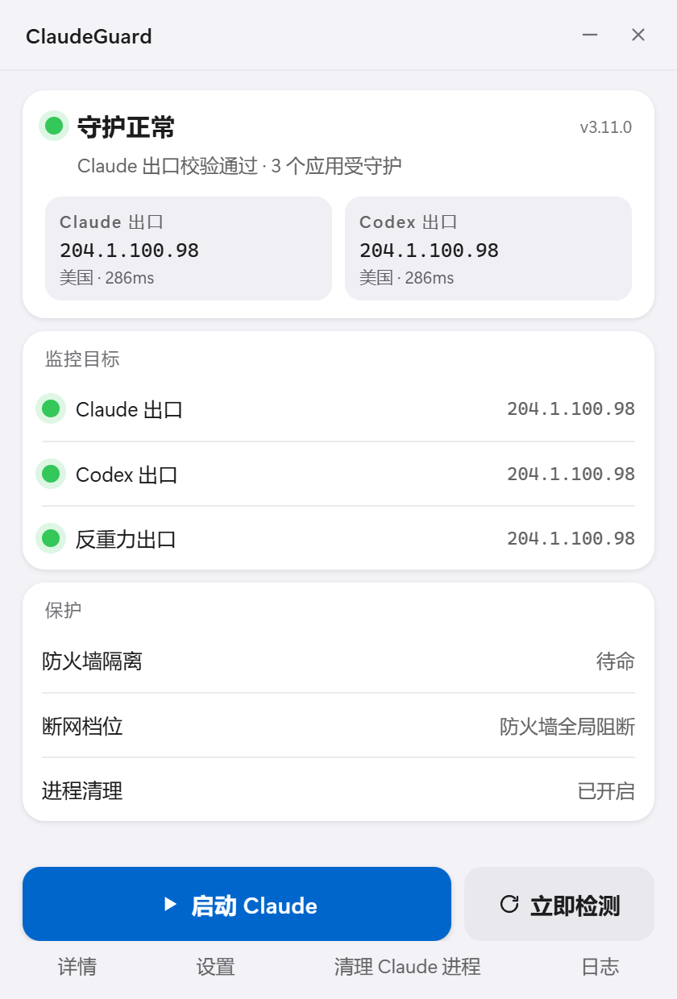
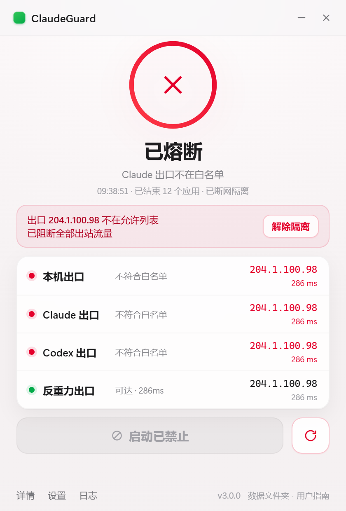
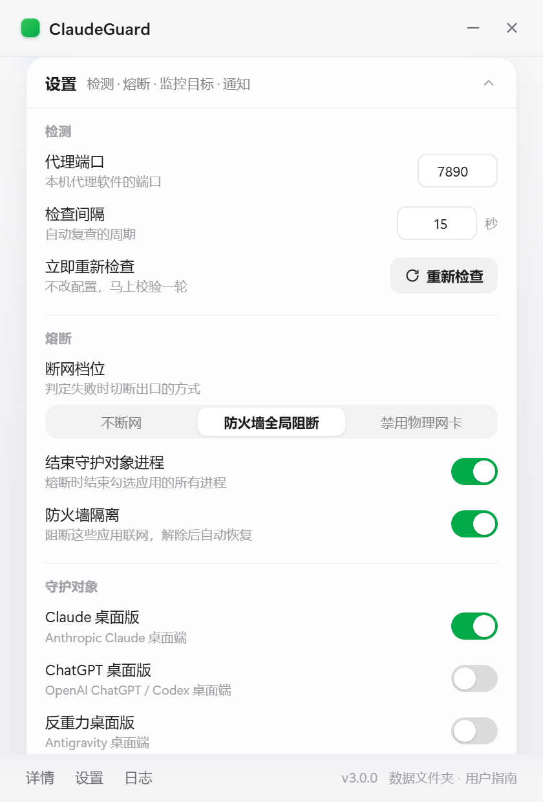
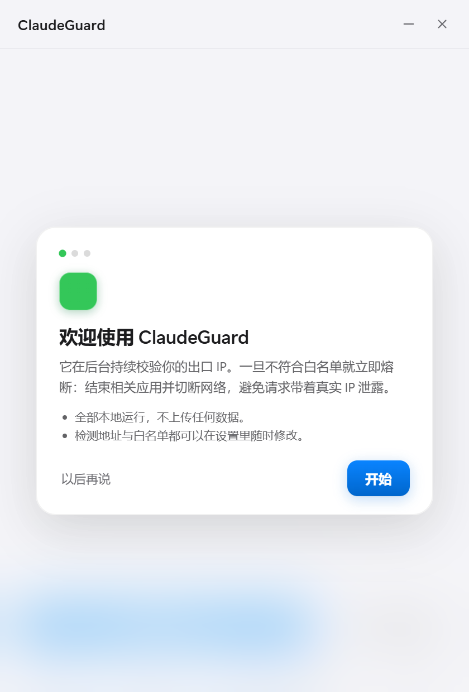
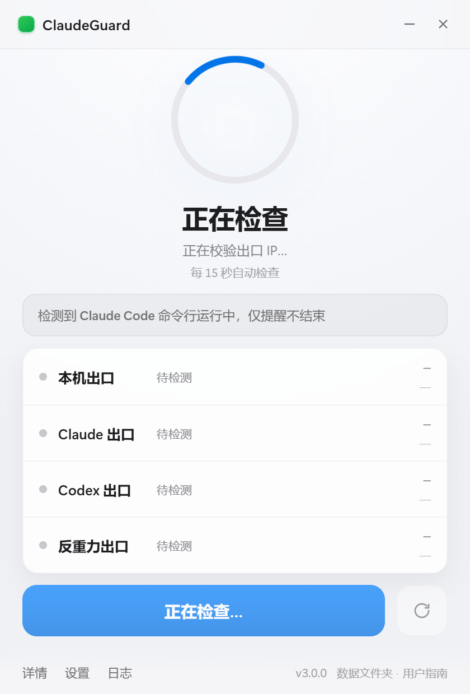

<p align="center">
  
</p>

<h1 align="center">ClaudeGuard (Claude 守护器)</h1>

<p align="center">
  <strong>给 AI 桌面应用加一道“网络出口门禁”</strong>
</p>

<p align="center">
  <a href="https://github.com/daha1216/ClaudeGuard/releases"></a>
  
  
  
</p>

---

### 一句话定位
ClaudeGuard 是 Windows 10/11 上的 AI 应用网络出口门禁：**按每个目标自己的域名**校验它此刻走的是哪条链路、出口 IP 与地区是否在白名单里；全部通过才允许启动 Claude 等桌面应用，任一启用目标不符合就立即熔断——结束相关进程、用防火墙隔离、必要时直接断网，切回合规节点后自动恢复。

### 为什么需要它
Claude、ChatGPT、反重力这些客户端对出口环境很敏感，而代理软件经常“整体一个出口”。当节点漂移、断连直连或者某个应用被单独分流时，应用会在你不知情的情况下从非预期出口联网。v3 的核心变化是把“系统出口”拆成**每个应用各测各的**：Claude 走 claude.ai 的 trace、Codex 走 chatgpt.com 的 trace、反重力测 Google 后端可达性——互不牵连，谁不对谁熔断。

---

## 界面预览

<table>
  <tr>
    <td align="center" width="50%"><br><sub>主界面 · 各目标出口逐一校验通过</sub></td>
    <td align="center" width="50%"><br><sub>熔断 · 结束进程 + 断网隔离，一键解除</sub></td>
  </tr>
  <tr>
    <td align="center" width="50%"><br><sub>设置 · 端口 / 白名单 / 断网档位 / 守护对象</sub></td>
    <td align="center" width="50%"><br><sub>首次向导 · 三步完成配置</sub></td>
  </tr>
</table>

<p align="center">
  <br>
  <sub>检测中 · 目标逐个回填出口 IP、地区与耗时</sub>
</p>

---

## 功能亮点

- **按目标校验出口（v3 核心）**：每个监控目标绑定自己的探测地址与期望值。Claude → `claude.ai/cdn-cgi/trace`，Codex → `chatgpt.com/cdn-cgi/trace`，反重力 → `cloudcode-pa.googleapis.com` 可达性，本机出口 → `cloudflare.com/cdn-cgi/trace`。支持 HTTP trace、JSON IP、页面地区标记、仅可达性四类锚点，自定义目标同样适用。
- **双重白名单**：多 IP 列表 + 出口地区（ISO 国家/地区码），任一命中即放行；期望为空的目标会被校验拦下，避免裸连。
- **防抖熔断**：连续 `2` 次（可调）失败才熔断，任意一次通过清零；探测失败/拿不到出口信息属于“无法确认”，不熔断。
- **熔断动作**：结束 Claude / ChatGPT / 反重力的全部进程 + 按开关做防火墙入/出站隔离 + 断网档位（关闭 / 防火墙全局出站阻断（默认）/ 禁用物理网卡）。
- **恢复零残留**：切回合规节点后下一轮自动解除隔离与断网；托盘“解除隔离并恢复网络”、`--restore` 急救、程序退出都会恢复网络。
- **常驻托盘**：默认每 15 秒复查一次（5–3600 秒可调），可“暂停守护 30 分钟”（暂停期间照常检测但绝不熔断）。
- **多 Agent 守护**：GUI 应用熔断杀进程，CLI（Claude Code / Codex CLI / Gemini CLI）只提醒不杀，避免误伤终端。
- **桌面通知 + 飞书群通知**：熔断、恢复、启动被阻止、失败预警、客户端更新五类桌面通知；飞书机器人支持签名校验、DPAPI 凭据加密、持久队列与失败补发。见 [飞书通知](docs/FEISHU.md)。
- **Claude / Codex 客户端更新**：只走官方 MSIX 源，校验签名与包身份后原位升级，注册版本达标才算完成。见 [客户端更新](docs/CLIENT-UPDATES.md)。
- **守护器自身更新**：基于 GitHub Releases 的版本检测、下载与自替换。
- **可脚本化**：`--check` 输出 JSON 与退出码，适合批处理和前置流水线。

---

## 守护范围与熔断方式

| 类型 | 支持目标 | 熔断机制 | 说明 |
| :--- | :--- | :--- | :--- |
| **GUI 桌面应用** | Claude / ChatGPT / 反重力 (Antigravity) | **结束进程 + 防火墙隔离** | 任意组合勾选；熔断时结束全部关联进程，并为其可执行文件添加 Windows 防火墙出/入站阻止规则。 |
| **CLI 命令行** | Claude Code / Codex / Gemini CLI | **仅日志提醒，绝不杀进程** | CLI 常驻在终端或 Node 环境里，杀进程会误伤整个终端，因此只记录提醒。 |

---

## 防误杀与放行语义

- **信息缺失不熔断**：探测超时、返回为空、拿不到 IP/地区时判为“无法确认”，只记录不熔断。
- **期望为空不放行**：某个目标的期望 IP 与地区都为空时，该目标永远不通过（宁可错杀），需要补白名单。
- **连续两次才熔断**：单次网络抖动不会立刻熔断；两次检查间隔默认 15 秒。
- **本机出口默认关闭**：本机常规流量出口往往与 AI 代理出口不同，默认开启会在首次启动就熔断；需要监管本机出口时在设置里打开并补齐白名单。

---

## 安装与快速上手

仅支持 **Windows 10 / 11**，界面全中文。在 [GitHub Releases](https://github.com/daha1216/ClaudeGuard/releases) 获取最新分发包：

1. **安装版（`ClaudeGuard-vX.Y.Z-setup.exe`）**
   - Inno Setup 打包，默认安装到 `C:\Program Files\ClaudeGuard`，自动检测 WebView2 运行时。
   - 需要管理员权限：熔断时要调用 Windows 防火墙与网卡控制接口。
   - 卸载可在“安装的应用”中完成，**刻意保留** `%APPDATA%\ClaudeGuard` 里的配置与日志。
2. **便携版（`ClaudeGuard-vX.Y.Z.zip`）**
   - 裸 exe，解压即用（同样需要管理员权限）。

### 首次运行向导
三步完成配置：代理端口 → 出口白名单（IP 可多个，或按地区）/ 守护对象 → 是否安装开机自启。完成后即进入常驻守护。

---

## 日常使用

- **主界面**：状态圆环 + 状态文案 + 每个目标一行（左：名称/地区，右：出口 IP/耗时），主按钮下「立即检测」随时手动复查。底部“详情 / 设置 / 日志”展开对应卡片。
- **设置**：代理端口、检查间隔、白名单（IP / 地区）、断网档位、熔断动作开关、守护对象、监控目标增删改、桌面通知与飞书、客户端更新、开机自启、关窗到托盘，以及「打开数据文件夹 / 用户指南」。
- **托盘菜单**（右键图标）：显示主窗口 / 立即检测 / 暂停守护 30 分钟（或恢复守护）/ 解除隔离并恢复网络 / 打开数据文件夹 / 退出。

### 命令行

```powershell
ClaudeGuard.exe --check        # 单次检测，JSON 输出；退出码 0 通过 / 2 不通过
ClaudeGuard.exe --restore      # 急救：恢复网络 + 解除全部隔离
ClaudeGuard.exe --settings     # 打开/唤起主窗口并展开设置
ClaudeGuard.exe --notify-test trip   # 测试桌面通知（trip/recover/launch_blocked/warning/client_update）
ClaudeGuard.exe --feishu-status --claude-update-status --codex-update-status
ClaudeGuard.exe --install --uninstall
```

`--check` 示例（截断）：

```json
{
  "version": "3.1.0",
  "passed": true,
  "targets": [
    { "id": "local", "name": "本机出口", "enabled": false, "verdict": "disabled" },
    { "id": "claude", "name": "Claude 出口", "enabled": true, "verdict": "pass", "ip": "204.1.100.98" },
    { "id": "codex", "name": "Codex 出口", "enabled": true, "verdict": "pass", "ip": "204.1.100.98" },
    { "id": "antigravity", "name": "反重力出口", "enabled": true, "verdict": "pass", "note": "可达" }
  ]
}
```

---

## 数据与隐私

- 配置与运行状态位于 `%APPDATA%\ClaudeGuard\`：
  - `config.json`：v3 配置（旧 v2 配置会在首次启动时自动迁移）。
  - `guard.log`：运行日志（超过 1MB 自动裁剪并保留最近约 400KB）。
  - `netcut.json`：断网现场，用于崩溃/被杀后的启动自愈。
  - `feishu.json`：DPAPI 加密凭据、通知队列与失败记录（队列正文未加密，可能含出口 IP）。
  - `claude-update.json` / `codex-update.json`：客户端更新状态，不含登录凭据。
- **探测请求**经你配置的本地代理发往各目标自己的探测域名（`claude.ai`、`chatgpt.com`、`cloudflare.com`、`cloudcode-pa.googleapis.com`），只用于读取出口 IP/地区或判断可达性，不上传任何应用数据。
- 守护器自身更新查询 GitHub Releases；客户端更新只访问官方 MSIX 源；飞书通知直连 HTTPS 发送事件正文。
- 不包含任何第三方统计或数据回传。

---

## 从源码构建

```powershell
cargo build --release        # 产物 target/release/claude-guard.exe
cargo test                   # 107 个单元测试
cargo clippy --all-targets -- -D warnings
node --check ui/*.js         # 纯静态前端，无 npm/构建步骤
```

- 技术栈：Rust + Tauri 2（WebView2，纯静态前端）、`sysinfo`（进程）、Windows 防火墙与网卡控制、`ureq`（探测）。
- 维护者约定、模块地图与已知坑见 [AGENTS.md](AGENTS.md)；v3 行为基准见 [docs/SPEC-v3.md](docs/SPEC-v3.md)；用户指南见 [docs/GUIDE.md](docs/GUIDE.md)。

---

## 版本沿革

- **v1.x**：Rust `egui` 单文件原型。
- **v2.x**：重写为 Tauri 2 架构，加入多 Agent 守护、飞书通知与客户端更新。
- **v3.x**：从零重构。按目标独立锚点校验、断网两档、桌面通知、A+ 极简仪表盘 UI、断网自愈与 `--restore` 急救。
