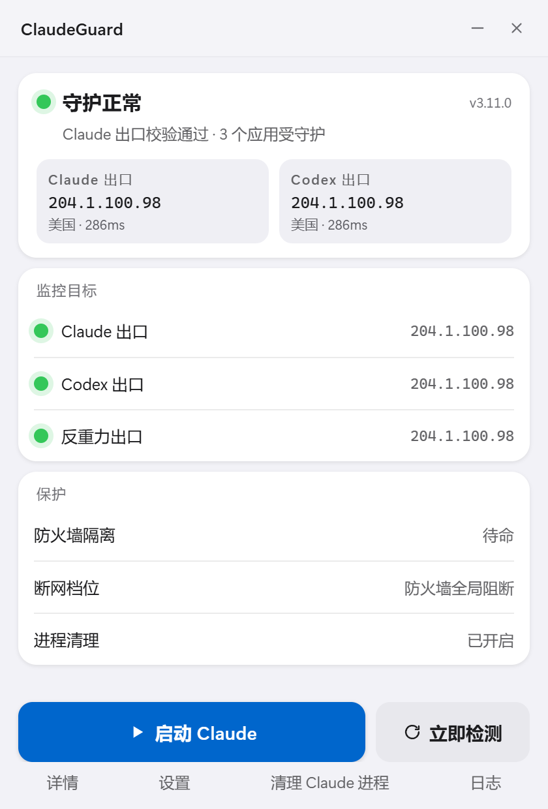
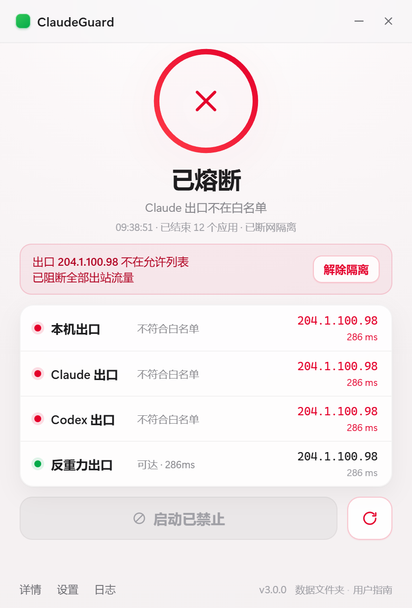
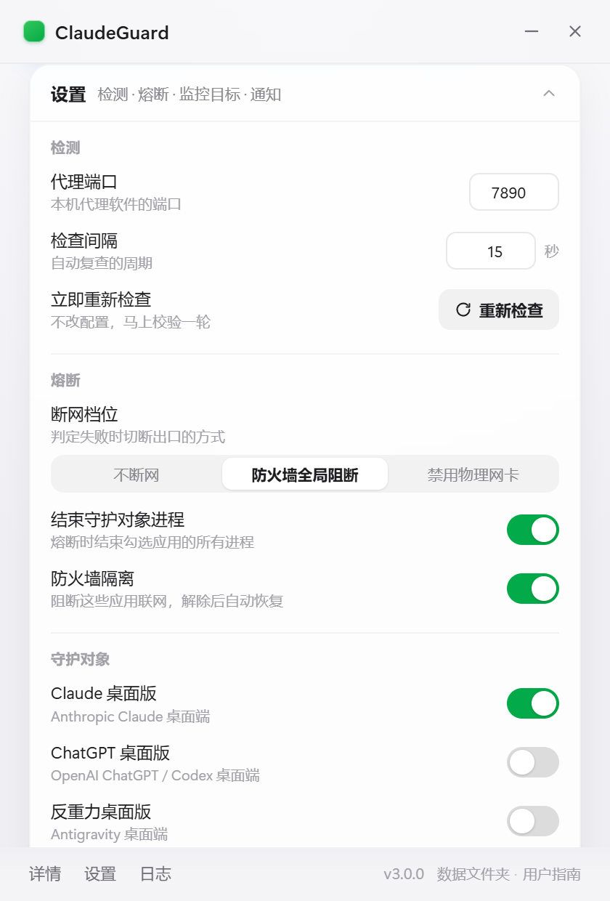
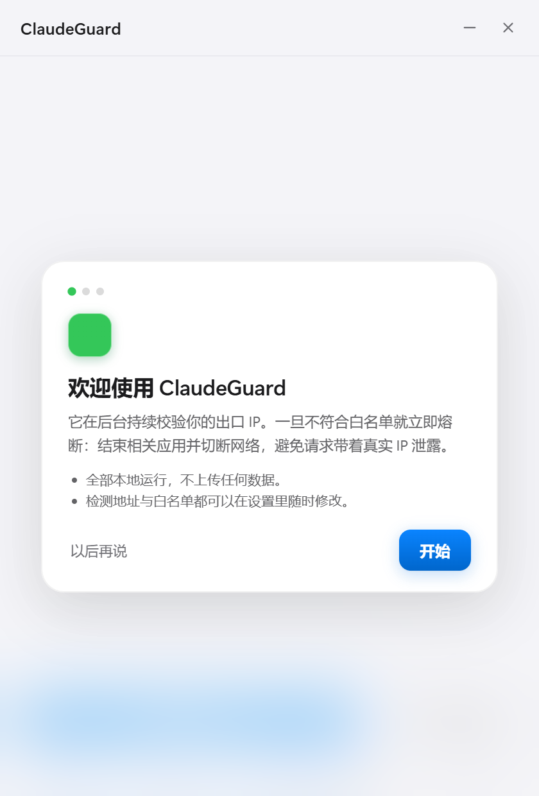
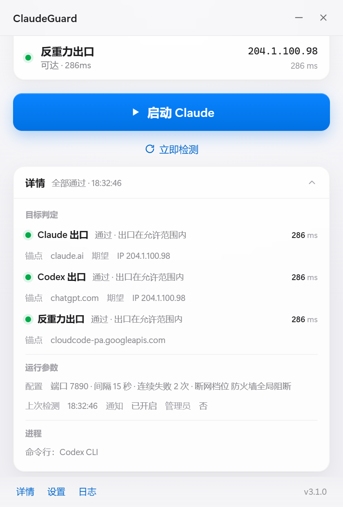

> **macOS preview**: the repository now ships a macOS port with a dark UI (process-guarding mode). This build has no system-level per-app network isolation; client upgrade/rollback and local self-update are verified, while official remote self-update still needs the maintainer's public key and macOS release assets. See the [macOS notes](docs/MACOS.md) for details and testing. Windows documentation follows.

<p align="center">
  
</p>

<h1 align="center">ClaudeGuard</h1>

<p align="center">
  <strong>A network-egress gate for your AI desktop apps</strong>
</p>

<p align="center">
  <a href="README.md">English</a> | <a href="README.zh-CN.md">简体中文</a>
</p>

<p align="center">
  <a href="https://github.com/daha1216/ClaudeGuard/releases"></a>
  
  
  
  
  
</p>

---

### In one sentence
ClaudeGuard is a **network-egress gate for AI desktop apps** (full support on Windows, preview port on macOS): it checks — **against each target's own domain** — which route the app is using right now and whether the egress IP and region are on your allowlist. Only when every enabled target passes may apps like Claude start; if any enabled target fails, ClaudeGuard trips at once — ends the related processes, isolates them with the firewall, cuts the network when configured — and restores everything automatically once you are back on a compliant node.

### Why you need it
Claude, ChatGPT and Antigravity clients are very sensitive to the environment their traffic exits from, while proxy software usually presents **one shared egress**. When a node drifts, the proxy drops and traffic goes direct, or one app gets routed separately, the app can silently reach the network from an unexpected exit — right when you are trying to keep the account in a supported region. In 2026 Anthropic's account enforcement tightened around exactly this: the official [supported-countries list](https://www.anthropic.com/supported-countries) defines the region red line, and community post-mortems such as [this one on network-based ban detection](https://blog.leeguoo.com/en/posts/claude-account-ban-network-detection/) describe how region and IP-type heuristics (datacenter vs. residential) get accounts flagged. ClaudeGuard does not run a proxy and does not touch your routing rules; it only verifies the egress **before** the app talks to the network, and trips first when something is off.

v3's core change is to split "the system egress" into **one probe per app**: Claude goes through `claude.ai`'s trace, Codex through `chatgpt.com`'s trace, Antigravity by Google backend reachability — independent of each other, so the one that is wrong is the one that trips.

### Core capabilities

1. **Per-target allowlist validation** — every monitored target binds its own probe URL and expected values (IP list and/or ISO country/region code); all enabled targets must pass before the guarded apps are allowed to run.
2. **Trip = kill processes + firewall isolation + optional network cut** — after the debounce threshold, ClaudeGuard ends the guarded GUI app processes, adds Windows firewall block rules for them, and can additionally cut the network (firewall-wide outbound block by default, or disabling the physical NIC).
3. **Recovery with the ledger first** — every system-changing action writes a ledger entry before it runs; recovery is idempotent and shared by auto-recovery, the tray "release & restore network" action, `--restore`, and program exit.
4. **Feishu notifications, self-update, and a `--check` CLI** — desktop + Feishu group notifications, GitHub Releases-based self-update, official-MSIX in-place client updates, and a scriptable `--check` that prints JSON with a meaningful exit code.

---

## Screenshots

<table>
  <tr>
    <td align="center" width="50%"><br><sub>Main · every target's egress validated, one click to launch</sub></td>
    <td align="center" width="50%"><br><sub>Tripped · processes ended + isolated, one click to release and restore the network</sub></td>
  </tr>
  <tr>
    <td align="center" width="50%"><br><sub>Settings · nine collapsible groups, each header shows the current values</sub></td>
    <td align="center" width="50%"><br><sub>First-run wizard · three steps to configure</sub></td>
  </tr>
</table>

<p align="center">
  <br>
  <sub>Details · anchor, expected values, latency and runtime parameters per target</sub>
</p>

---

## Highlights

- **Per-target egress validation (the v3 core)**: each monitored target binds its own probe address and expected values. Claude → `claude.ai/cdn-cgi/trace`, Codex → `chatgpt.com/cdn-cgi/trace`, Antigravity → reachability of `cloudcode-pa.googleapis.com`, local egress → `cloudflare.com/cdn-cgi/trace`. Four anchor kinds are supported — HTTP trace, JSON IP, page region marker, reachability-only — and custom targets use the same machinery.
- **Access-path check (v3.7/3.8)**: probes follow the system proxy (so changing the port or the proxy app still measures the app's real egress); with the system proxy off, TUN adapter presence decides access, and neither present means the app would go direct to its real egress → handled by the trip threshold (kill / isolate / cut). In that state the guard itself **does not probe directly** — under no circumstances does ClaudeGuard's own traffic leave the machine with your home IP.
- **Firewall fallback lockdown (v3.9)**: with no proxy attached (no system proxy and no TUN), ClaudeGuard automatically adds outbound firewall Block rules for the guarded apps — direct egress is blocked, going through the system proxy still works, and the rules drop automatically once access is restored; a one-click manual lockdown/release is also available. Windows Firewall is turned on automatically when needed (default outbound = allow, other software unaffected), but it is never turned off for you.
- **Dual allowlist**: multiple IP entries plus egress region (ISO country/region codes) — any match passes; targets whose expectations are empty are rejected by validation, so nothing can run bare.
- **Debounced tripping**: `2` consecutive failures (configurable) are required to trip, and any single pass resets the counter; probe failures or missing egress info count as "unverified" and do not trip.
- **Trip actions**: end all Claude / ChatGPT / Antigravity processes + firewall in/outbound isolation per the switches + network-cut level (off / firewall-wide outbound block (default) / disable physical NIC).
- **Zero-residue recovery**: the next round after switching back to a compliant node releases isolation and the network cut automatically; the tray's "release & restore network", the `--restore` emergency command, and program exit all restore networking.
- **Resident tray**: re-checks every 15 seconds by default (5–3600 s configurable); "pause guarding for 30 minutes" keeps detecting but never trips.
- **Multi-agent guarding**: GUI apps are killed on trip, CLIs (Claude Code / Codex CLI / Gemini CLI) only get a log reminder so your terminal is never collateral damage.
- **Desktop + Feishu notifications**: trip, recovery, launch-blocked, failure warning, client-update desktop toasts; the Feishu bot supports signature verification, DPAPI-encrypted credentials, a persistent queue and retry-on-failure. See [Feishu notifications](docs/FEISHU.md).
- **Claude / Codex client updates**: official MSIX sources only, signature and package-identity verified, in-place upgrade that only counts as done once the registered version matches. See [client updates](docs/CLIENT-UPDATES.md).
- **Self-update**: version check, download and self-replacement based on GitHub Releases.
- **Scriptable**: `--check` prints JSON with exit codes — ready for batch jobs and pre-flight pipelines.

---

## Guarded scope & trip mechanisms

| Type | Supported targets | Trip mechanism | Notes |
| :--- | :--- | :--- | :--- |
| **GUI desktop apps** | Claude / ChatGPT / Antigravity | **End processes + firewall isolation** | Any combination; on trip all associated processes are ended and Windows firewall in/outbound block rules are added for their executables. |
| **CLI tools** | Claude Code / Codex CLI / Gemini CLI | **Log reminder only, never killed** | CLIs live in your terminal or a Node process; killing them would take the whole terminal down, so they are only recorded. |

---

## Fail-safe & pass semantics

- **Missing information never trips**: probe timeout, empty response, no IP/region → judged "unverified", logged only.
- **Empty expectations never pass**: a target whose expected IP list and region list are both empty never passes (better safe than sorry) — fill in the allowlist.
- **Two in a row before tripping**: a single network blip won't trip anything; the check interval defaults to 15 seconds.
- **Local egress target is disabled by default**: your normal traffic usually exits from a different IP than the AI proxy, so enabling it by default would trip on first start; turn it on in settings and fill the allowlist if you really want to guard it.

---

## Install & quick start

Windows 10 / 11 only; the UI is fully in Chinese (community translations welcome — see [CONTRIBUTING.md](CONTRIBUTING.md)). Grab the latest package from [GitHub Releases](https://github.com/daha1216/ClaudeGuard/releases):

1. **Installer (`ClaudeGuard-vX.Y.Z-setup.exe`)**
   - Inno Setup package, installs to `C:\Program Files\ClaudeGuard` by default, checks for the WebView2 runtime.
   - Needs administrator rights: tripping calls the Windows firewall and NIC control interfaces.
   - Uninstall from "Installed apps"; it **deliberately keeps** config and logs in `%APPDATA%\ClaudeGuard`.
2. **Portable (`ClaudeGuard-vX.Y.Z.zip`)**
   - Bare exe, unzip and run (administrator rights still required).

### 3-step quick start
1. **Download** the installer or the portable zip from Releases and run it (admin elevation is required).
2. **Fill the first-run wizard**: local proxy port + allowlist IPs (several allowed) and/or egress region — *leaving both empty means nothing ever passes, and the guard trips and isolates the network about 30 seconds after start*, so the wizard shows an explicit gate warning and requires a second confirmation before you may skip it.
3. **Pick an install mode** — "Install & continue" (registers Start menu + boot autostart) or "Use portable" (no registry writes) — and resident guarding starts.

### First-run wizard
Three steps: ① welcome & capability overview → ② proxy & allowlist (proxy port + allowlist IPs + egress region; **both left empty = permanent tripping**, gated with a warning and a confirm-twice skip) → ③ install mode ("Install & continue" registers the Start menu and boot autostart / "Use portable" runs from the current directory without touching the registry). Afterwards ClaudeGuard runs resident in the tray.

---

## macOS (preview port)

Since v3.6.0 the repository ships a macOS port (community contribution, process-guarding mode, dark UI). **No prebuilt package yet** — build from source:

```bash
git clone https://github.com/daha1216/ClaudeGuard && cd ClaudeGuard
cargo build --release            # needs Xcode Command Line Tools
python3 scripts/package-macos.py # produces ClaudeGuard.app (ad-hoc signed)
```

Drag `ClaudeGuard.app` into "Applications" and run it; it walks the same three-step wizard as Windows.

**Capability matrix vs. Windows**:

| Capability | Windows | macOS (preview) |
| :--- | :--- | :--- |
| Per-target egress validation / allowlist / debounced trip | ✅ | ✅ same semantics |
| Trip actions | End processes + firewall isolation + network-cut levels | **End processes only** (process-guarding mode, no network cut) |
| Launch gate (blocked from starting Claude while egress is invalid) | ✅ | ✅ |
| Feishu / desktop notifications / client updates | ✅ DPAPI / Toast / MSIX in-place upgrade | ✅ Keychain+AES-GCM / native notifications / signed official-package upgrade |
| Self-update | ✅ GitHub Releases self-replacement | local signed-package flow verified; remote publishing needs the maintainer's Minisign public key |
| Login autostart | ✅ | ✅ LaunchAgent |

Known limits: no system-level per-app isolation (a window exists between two checks); no Developer ID notarization; Intel builds verified only through Rosetta. See [docs/MACOS.md](docs/MACOS.md) (usage) and [docs/MACOS-VALIDATION.md](docs/MACOS-VALIDATION.md) (validation record).

---

## Daily use

- **Main window**: the hero card shows a status dot + status title + version + one subtitle line, with Claude/Codex egress tiles underneath; below sit the "Monitored targets" and "Protection" group cards, one row per target (left: name/region, right: egress IP/latency). Tripped and paused states have **no banner** — they are expressed by the hero title and the primary button (tripped → "Release & restore network", paused → "Resume guarding"). Next to the primary button in the CTA area is "Re-check now". Footer links: Details / Settings / Sweep Claude processes / Logs, each opening its card.
- **Settings**: nine collapsible groups — Detect (proxy port, check interval, access-path check), Trip & cleanup (network-cut level, trip action switches, process sweep, firewall lockdown), Env & leak (direct-connection watch, environment consistency and timezone/location alignment), Guarded apps, Monitored targets (add/edit/remove), Notifications (desktop), Feishu, General (boot autostart, close-to-tray, open data folder / user guide), Updates (the guard itself plus Claude/Codex clients); every group header summarizes the current values.
- **Tray menu** (right-click the icon): Show main window / Re-check now / Pause guarding 30 minutes (or resume) / Release & restore network / Open data folder / Quit.

### Command line

```powershell
ClaudeGuard.exe --check        # single check, JSON output; exit 0 pass / 2 not passed
ClaudeGuard.exe --restore      # emergency: restore network + release all isolation
ClaudeGuard.exe --settings     # open/raise the main window and expand Settings
ClaudeGuard.exe --notify-test trip   # test desktop notification (trip/recover/launch_blocked/warning/client_update/self_update)
ClaudeGuard.exe --feishu-status --claude-update-status --codex-update-status
ClaudeGuard.exe --install --uninstall
```

`--check` sample (truncated):

```json
{
  "version": "3.12.5",
  "passed": true,
  "targets": [
    { "id": "local", "name": "本机出口", "enabled": false, "verdict": "disabled" },
    { "id": "claude", "name": "Claude 出口", "enabled": true, "verdict": "pass", "ip": "198.51.100.98" },
    { "id": "codex", "name": "Codex 出口", "enabled": true, "verdict": "pass", "ip": "198.51.100.98" },
    { "id": "antigravity", "name": "反重力出口", "enabled": true, "verdict": "pass", "note": "可达" }
  ]
}
```

---

## FAQ

- **It keeps tripping right after start — why?** Almost always an empty allowlist: if a target's expected IPs and region are both empty it never passes, and the guard trips and isolates about 30 seconds after start. Fill at least one allowlist IP or pick an egress region in the wizard or in Settings → Monitored targets.
- **Why is the "local egress" target off by default?** Your ordinary traffic usually exits from a different IP than your AI proxy; enabling it by default would trip on first start. Turn it on in Settings and complete its allowlist if you want it guarded.
- **A probe failure doesn't trip — is the guard broken?** No. Timeouts or missing IP/region are judged "unverified" and only logged; tripping requires *sufficient information proving a mismatch*, twice in a row.
- **The update check says "GitHub API rate limit"** — anonymous GitHub API allows 60 requests/hour; the guard retries on its next 6-hour cycle. It never falls back to a direct connection for this.
- **macOS: no firewall isolation or network cut?** Correct — the macOS port is process-guarding only; see the capability matrix above.

---

## Data & privacy

- Config and runtime state live in `%APPDATA%\ClaudeGuard\`:
  - `config.json`: v3 config (old v2 config is migrated automatically on first start).
  - `guard.log`: run log (auto-trimmed above 1 MB, keeping roughly the latest 400 KB).
  - `netcut.json`: network-cut scene, used for start-up self-healing after a crash or kill.
  - `feishu.json`: DPAPI-encrypted credentials, notification queue and failure records (queue bodies are plaintext and may contain egress IPs).
  - `claude-update.json` / `codex-update.json`: client-update state, no login credentials.
- **Probe requests** travel through your configured local proxy to each target's own probe domain (`claude.ai`, `chatgpt.com`, `cloudflare.com`, `cloudcode-pa.googleapis.com`) and are used only to read the egress IP/region or test reachability — no application data is uploaded.
- Self-update queries GitHub Releases; client updates only touch official MSIX sources; Feishu notifications are sent over direct HTTPS.
- No third-party analytics or telemetry of any kind.

---

## Build from source

```powershell
cargo build --release        # artifact: target/release/claude-guard.exe
cargo test                   # unit tests (212 at the v3.12.4 release, more after the macOS port)
cargo clippy --all-targets -- -D warnings
node --check ui/*.js         # pure static frontend, no npm/build step
```

macOS: `cargo build --release && python3 scripts/package-macos.py` (see the section above).

- Stack: Rust + Tauri 2 (WebView2, static frontend), `sysinfo` (processes), Windows firewall & NIC control, `ureq` (probing).
- Maintainer conventions, module map and known pitfalls: [AGENTS.md](AGENTS.md); v3 behavior baseline: [docs/SPEC-v3.md](docs/SPEC-v3.md); user guide: [docs/GUIDE.md](docs/GUIDE.md); release history: [CHANGELOG.md](CHANGELOG.md).

---

## Version history

- **v1.x**: single-file Rust `egui` prototype.
- **v2.x**: rewritten on Tauri 2, adding multi-agent guarding, Feishu notifications and client updates.
- **v3.x**: rewritten from scratch — per-target anchor validation, two network-cut levels, desktop notifications, A+ minimal dashboard UI, network-cut self-healing and `--restore` emergency recovery.
- **v3.1.2**: fixed desktop toasts never appearing on systems that had never registered the app (the Toast AUMID must be registered under `HKCU\Software\Classes\AppUserModelId`); test notifications now send on a background thread and no longer block the UI.
- **v3.5.0**: silent self-update check every 6 hours with a desktop toast (same version reminded only once).
- **v3.6.0**: merged the community macOS port (process-guarding mode + dark UI, PR #2); no behavior change on Windows.
- **v3.7.0**: access-path check — probes follow the system proxy; with the system proxy off and no TUN adapter the state is "not connected" and a trip fires, stopping apps from bypassing the proxy to their real egress.
- **v3.8.0**: when not connected, the guard itself stops probing directly (privacy hardening); verdicts and tripping rely entirely on the registry/TUN checks.
- **v3.9.0**: firewall fallback lockdown — outbound Block rules per app exe while not connected, dropped automatically on reconnect; also fixed existing isolation rules not applying while the firewall was off.
- **v3.10.0**: hardening mainline — network-cut self-healing and the recovery protocol (recovery split into "safe restore" vs "stop guarding"), manual lockdown, the stopped-guarding state, config `version=4` (new installs default to no network cut, old config backed up before upgrade), idle overhead down to ~0.5% of one core.
- **v3.11.0**: main window restructured into "hero card + group cards", CTA moved out of the scroll area, tripped/paused states expressed via title and primary button.
- **v3.12.0**: direct-connection leak watch (warn on connections that bypass the proxy in system-proxy mode), environment consistency check, and automatic one-click timezone/default-location alignment (all ledger-backed, always reversible).
- **v3.12.4**: fixed firewall self-healing never triggering on non-English systems (structured `Get-NetFirewallProfile` status instead of parsing localized netsh text); corrected the netsh "no matching rule" match string; TLS stack patch bumps (rustls / rustls-webpki / webpki-roots / tokio); CI runs unit tests and gains a macOS job; added the MIT license.
- **v3.12.5**: dependency security alignment — `zip` to 9.x (the patched line for RUSTSEC-2026-0367/0369; 2.x has no fixed version), `quick-xml` to 0.42 (RUSTSEC-2026-0194/0195 fixed in 0.41, also removing a duplicate version from the lockfile); macOS port symbols completed so the macOS job compiles for the first time; a PowerShell-cold-start test timeout relaxed to remove CI flakiness.

See [CHANGELOG.md](CHANGELOG.md) for the unreleased work currently on `master`.

---

## License

[MIT](LICENSE) © 2026 daha1216
