<p align="center">
  
</p>

<h1 align="center">ClaudeGuard v4（Claude 守护器）</h1>

<p align="center">
  <strong>Windows Service 后台守护 + 原生 GPUI 桌面端 AI 网络出口门禁</strong>
</p>

<p align="center">
  <a href="README.md">English</a> | <a href="README.zh-CN.md">简体中文</a>
</p>

<p align="center">
  <a href="https://github.com/daha1216/ClaudeGuard/releases"></a>
  
  
  
  
</p>

> **架构演进说明**：从 **v4.0.0** 起，ClaudeGuard 从 Tauri 2 单文件升级为 **Windows Service 守护端（`claudeguard-daemon.exe`）+ 原生 Rust GPUI 桌面端（`claudeguard-gui.exe`）+ 应急命令行（`claudeguard-cli.exe`）** 三端解耦架构——**摆脱 WebView2 运行时依赖、日常使用零 UAC 弹窗**，内置 WAL 崩溃回滚账本。旧版 v3 代码（含社区 macOS 移植预览）完整保留在 [`v3`](https://github.com/daha1216/ClaudeGuard/tree/v3) 分支与 [`v3.12.5`](https://github.com/daha1216/ClaudeGuard/releases/tag/v3.12.5) 标签。

---

### 一句话定位

ClaudeGuard 是运行在 **Windows 10 / 11 上的 AI 工具只读出口门禁与防泄露守护系统**：按目标自己的域名**仅经你配置的本地代理只读探测**真实出口 IP、国家/地区与后端可达性（**绝不代切代理节点、绝不改写你的代理分流策略、绝不直连回退**）；全部合规才经安全启动台放行拉起桌面客户端与 CLI，一旦越界立即隔离进程与出站流量，并通过 WAL 账本在切回合规或 `--restore` 时零残留恢复。

### 为什么需要它

`Claude Desktop`、`ChatGPT / Codex`、`Antigravity IDE` 以及 `Claude Code CLI` / `Codex CLI` 对出口地区与 IP 信誉极其敏感，而代理软件常出现节点意外漂移、断代理裸连、或被 `UDP:443 QUIC`、明文 `DNS:53 / DoH`、双栈 `IPv6`、子进程（如 Antigravity 的 `language_server` 与 MCP 插件进程）悄悄绕过。

ClaudeGuard 坚持**只读观测、先拦后放**：不干涉用户的代理分流脚本，只在应用联网前后核验环境是否合规，在风险请求真正发出前先行拦截。

---

## 真实 GPUI 界面预览（Frost Ceramic 设计语言）

以下全部截图均采集自 `claudeguard-gui.exe` 真实运行窗口（Rust + Zed `gpui` 原生渲染，支持浅色 / 暗夜 / 跟随系统自适应）。

### 总览与熔断隔离态（浅色 / 暗夜 / 托盘快捷 HUD）

<table>
  <tr>
    <td align="center" width="50%">
      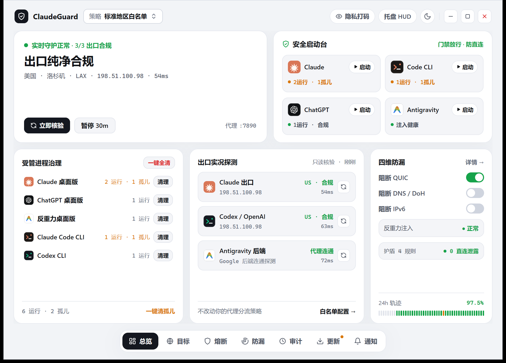<br>
      <sub><strong>总览 · Frost Ceramic 浅色模式</strong> — 顶部全局策略切换、出口纯净 Hero、2×2 安全启动台、受管进程治理、只读出口实况探测与四维防漏轨迹</sub>
    </td>
    <td align="center" width="50%">
      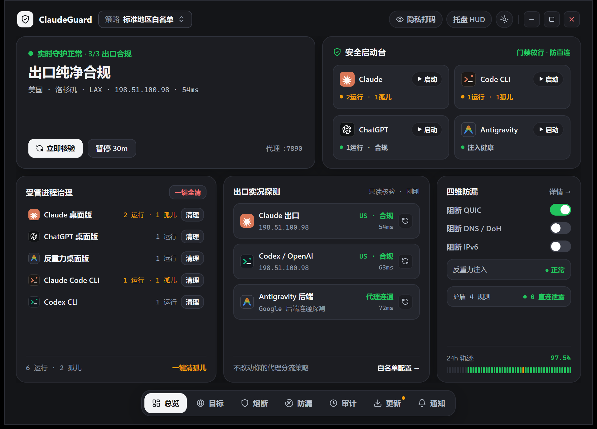<br>
      <sub><strong>总览 · Obsidian 暗夜模式</strong> — 跟随 Windows 深色偏好的护眼石墨配色，品牌图标暗色自适应，无刺眼白边</sub>
    </td>
  </tr>
  <tr>
    <td align="center" width="50%">
      <br>
      <sub><strong>熔断隔离锁定态</strong> — 期望与实测双行诊断直观定位越界 IP、2×2 安全启动台全锁禁拉起、越界目标标红与一键复查解封 / 暂不用 AI 解封</sub>
    </td>
    <td align="center" width="50%">
      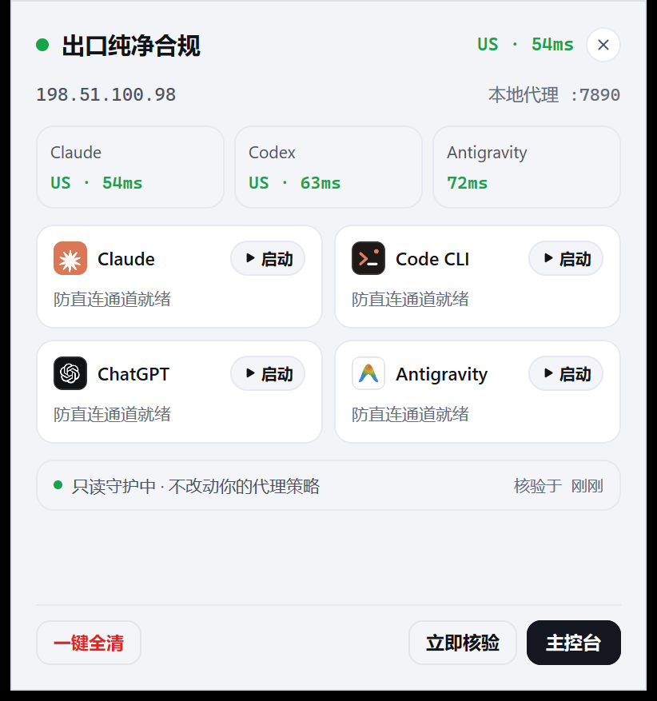
      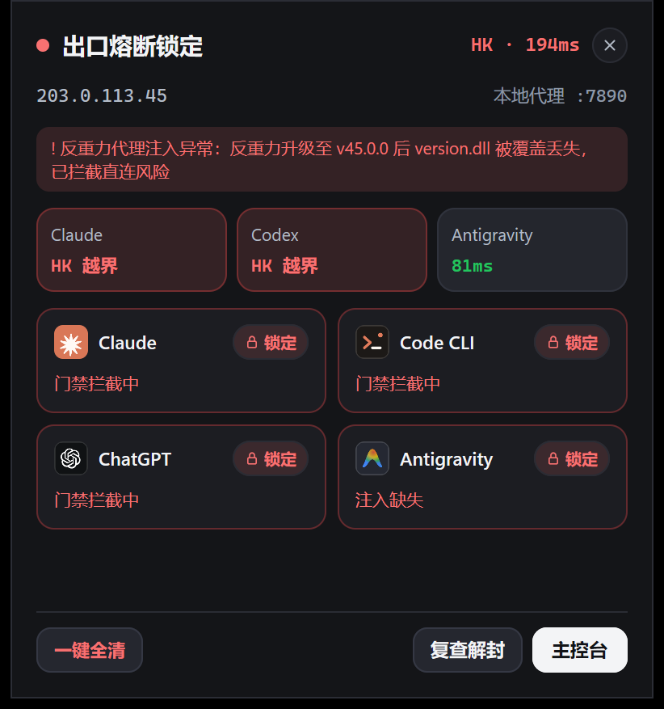<br>
      <sub><strong>模式 A · 托盘快捷 HUD（398×432）</strong> — 锚定任务栏右下角；3 目标速览、反重力注入异常换行告警、2×2 启动卡与一键全清 / 复查 / 主控制台</sub>
    </td>
  </tr>
</table>

### 目标策略、熔断防线与四维防漏护盾

<table>
  <tr>
    <td align="center" width="50%">
      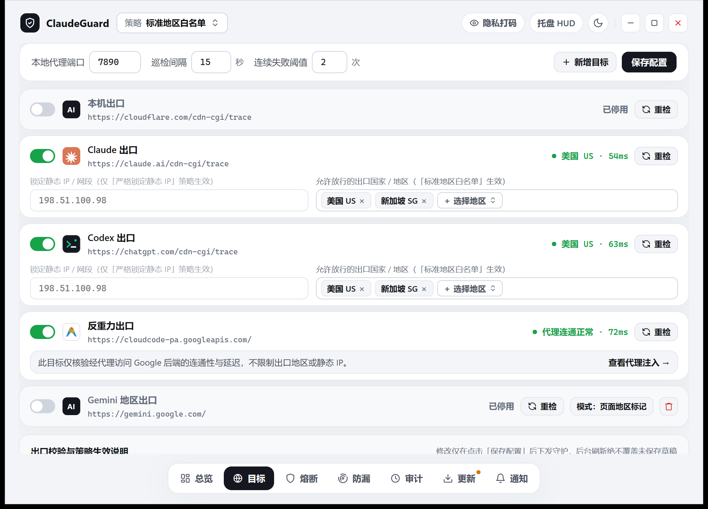<br>
      <sub><strong>目标与出口策略</strong> — 顶部三档全局策略（<code>标准地区白名单</code> / <code>严格锁定静态 IP</code> / <code>宽松防直连</code>）、CIDR 锁定、12 地区可视化多选器与自定义目标</sub>
    </td>
    <td align="center" width="50%">
      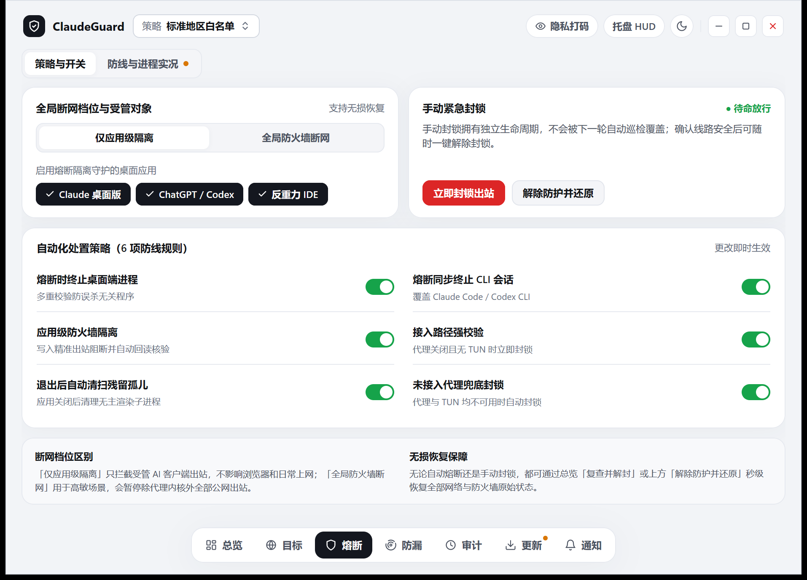<br>
      <sub><strong>熔断策略与紧急封锁</strong> — 「仅应用级隔离 / 全局防火墙断网」两档开关、受管桌面应用勾选、手动紧急封锁与 6 项防抖/孤儿清理开关</sub>
    </td>
  </tr>
  <tr>
    <td align="center" width="50%">
      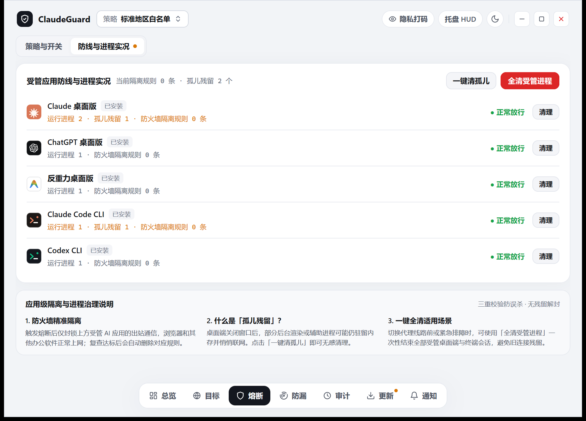<br>
      <sub><strong>防线与进程实况</strong> — Windows 防火墙多配置文件自检，逐应用展示运行实例、孤儿进程与当前隔离规则数，一键精准清理</sub>
    </td>
    <td align="center" width="50%">
      <br>
      <sub><strong>4 维防漏护盾与 MCP 雷达</strong> — 按可执行文件路径精准写入防火墙规则封堵 <code>UDP:443 QUIC</code>、<code>DNS:53 &amp; DoH</code> 与公网 <code>IPv6</code>，并实时扫描直连与 MCP 子进程（自动豁免回环与 TUN）</sub>
    </td>
  </tr>
</table>

### 反重力注入守护、时区指纹与 24 小时合规审计

<table>
  <tr>
    <td align="center" width="50%">
      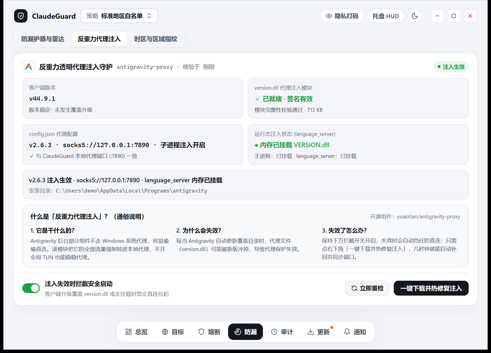<br>
      <sub><strong>反重力代理注入守护</strong> — 深度检测 <a href="https://github.com/yuaotian/antigravity-proxy">yuaotian/antigravity-proxy</a>（<code>version.dll</code> 完整性、<code>config.json</code> 端口一致与 <code>language_server</code> 运行态挂载），更新覆盖自动拦截并支持一键热修复</sub>
    </td>
    <td align="center" width="50%">
      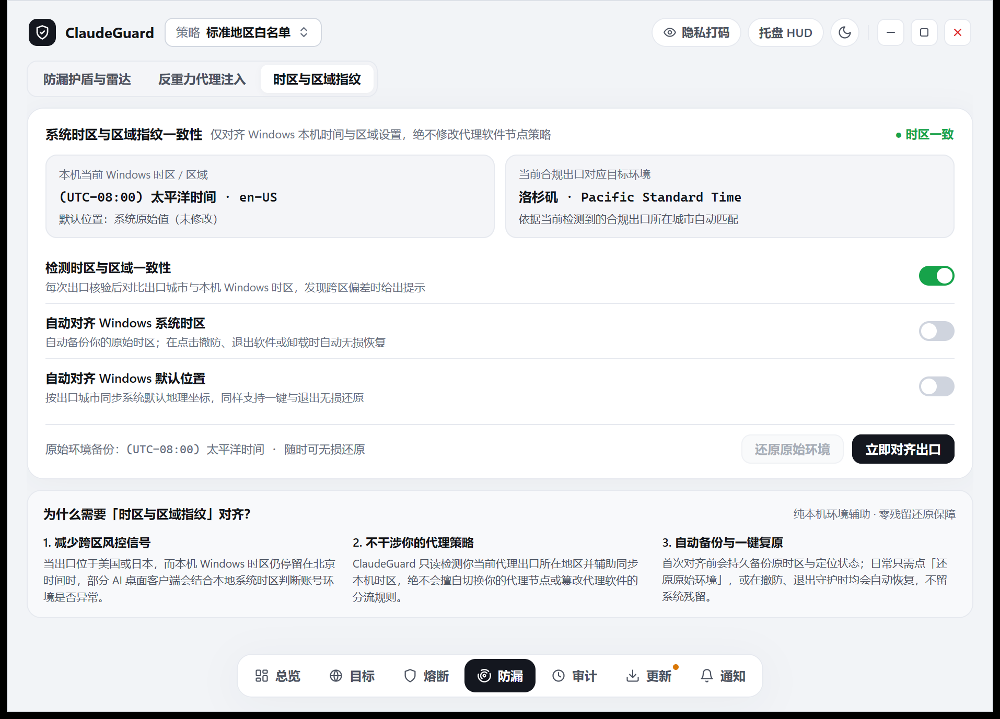<br>
      <sub><strong>时区与区域指纹对齐</strong> — 仅调整 Windows 本机时区与默认定位坐标以匹配合规出口城市，绝不改动代理节点；先写 <code>env_backup.json</code> 备份，支持一键无损还原</sub>
    </td>
  </tr>
  <tr>
    <td align="center" width="50%">
      <br>
      <sub><strong>审计与 24h 合规轨迹</strong> — 48 格半小时粒度交互式时间轴点击筛选、<code>Ctrl+K</code> 全文过滤与一键导出自动脱敏（隐去用户名、本地路径与 IP 后两段）的 <code>.zip</code> 诊断包</sub>
    </td>
    <td align="center" width="50%">
      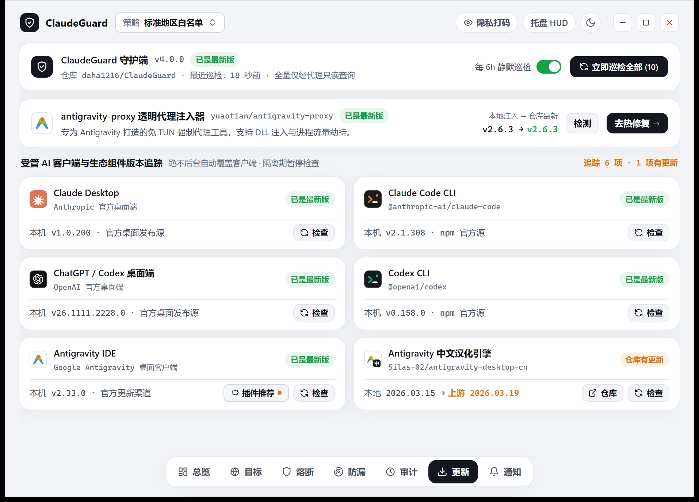<br>
      <sub><strong>版本巡检中心（10 组件）</strong> — 全程仅经代理只读检查 ClaudeGuard、<code>antigravity-proxy</code>、Claude / Codex 桌面端与 CLI、Antigravity IDE 及 <a href="https://github.com/Silas-02/antigravity-desktop-cn">antigravity-desktop-cn</a></sub>
    </td>
  </tr>
</table>

### Antigravity 插件推荐、桌面与飞书通知

<table>
  <tr>
    <td align="center" width="50%">
      <br>
      <sub><strong>Antigravity 精选插件与更新检测</strong> — 自动识别本机已装版本并只读比对 <a href="https://github.com/yuhuan-dev/antigravity-usage-monitor">antigravity-usage-monitor</a>、<a href="https://github.com/Lumidarin/agy-capsule">agy-capsule</a>、<a href="https://github.com/Silas-02/antigravity-desktop-cn">antigravity-desktop-cn</a> 与 <a href="https://github.com/yuaotian/antigravity-proxy">antigravity-proxy</a></sub>
    </td>
    <td align="center" width="50%">
      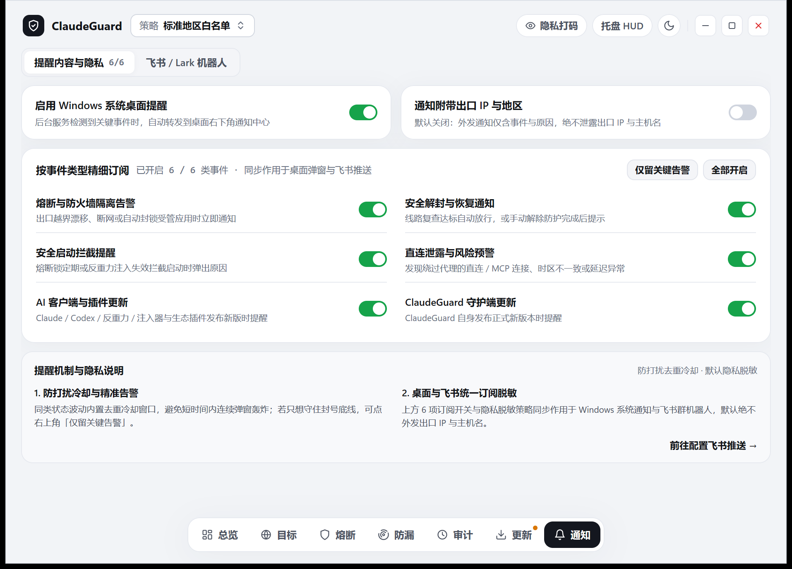<br>
      <sub><strong>桌面提醒与隐私脱敏</strong> — 6 类事件精细开关、一键「仅留关键告警」、默认隐藏外网 IP 与主机名，经守护端将告警中继到当前登录桌面通知中心</sub>
    </td>
  </tr>
</table>

<p align="center">
  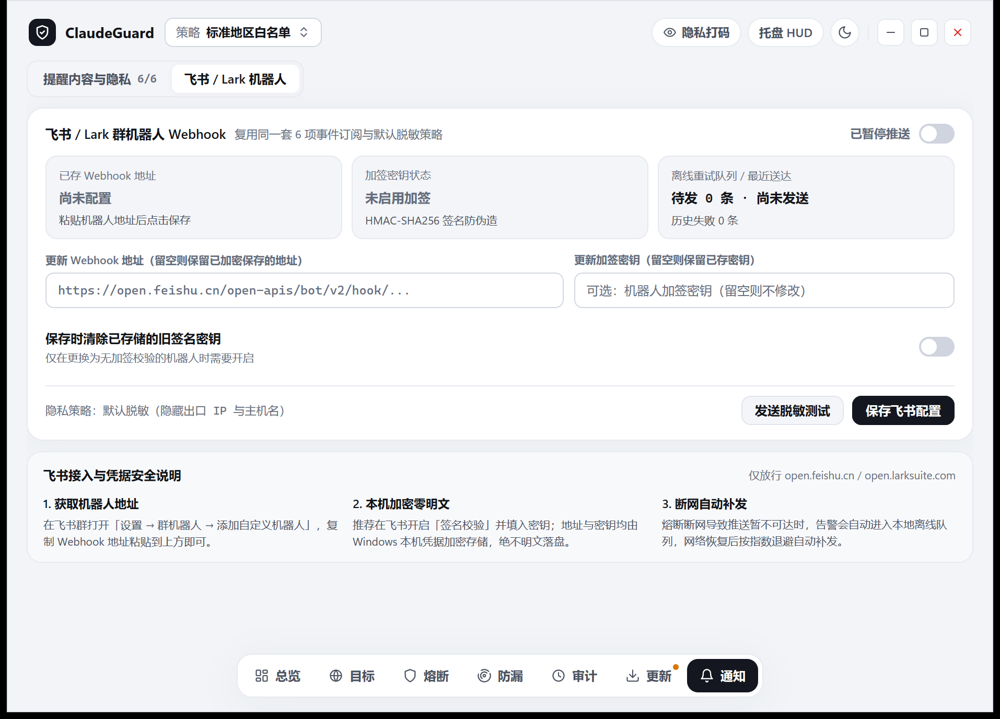<br>
  <sub><strong>飞书 / Lark 群机器人</strong> — HMAC-SHA256 加签校验、Windows <code>DPAPI</code> 本地加密存储、断网指数退避离线重发队列与脱敏测试发送</sub>
</p>

---

## v4 核心能力

1. **Windows Service 权限隔离，日常零 UAC 弹窗**：
   - `claudeguard-daemon.exe` 注册为开机自启 `ClaudeGuardService`（`LocalSystem`），接管防火墙、进程清理、防漏规则与时区同步；
   - `claudeguard-gui.exe`（`asInvoker` 普通用户权限）通过设防的 Named Pipe `\\.\pipe\ClaudeGuardV4`（SDDL 授权交互式用户 + `PIPE_REJECT_REMOTE_CLIENTS` 拒绝远程连接）与守护通信，并以普通用户身份通过安全启动台拉起 AI 应用；
   - `--tray` 驻留模式下仅保留托盘图标，不常驻渲染窗口（**0 窗口显存占用**）。
2. **WAL 崩溃回滚账本（`journal.json`）**：
   - 所有改动系统状态的动作先写 WAL 事务并 `sync_all` 落盘再执行 OS 操作；服务启动自检、恢复放行、`--restore` 离线急救均按同一套幂等恢复协议回查清零。
3. **只读代理探测，绝不直连回退，绝不改分流策略**：
   - `Claude` → `claude.ai/cdn-cgi/trace`，`Codex` → `chatgpt.com/cdn-cgi/trace`，`Antigravity` → `daily-cloudcode-pa.googleapis.com` 经代理连通性探测，`本机出口`（默认停用）→ `cloudflare.com/cdn-cgi/trace`，并支持新增 HTTP Trace / JSON IP / 页面地区 / 仅可达性四类自定义目标。
   - 任何探测与 GitHub / npm 更新检查均强制走配置代理或 TUN；代理未接入时守护器绝不带着本机真实 IP 直连外网。
4. **4 维防漏护盾 + Antigravity 生态深护**：
   - 将防火墙阻断规则精确绑定到已安装的受管 AI 客户端可执行文件路径，**绝不影响浏览器、游戏和日常软件**；
   - 专项监控 `antigravity-proxy` 注入文件是否在 IDE 自动更新后被覆盖，并提供 10 组件（含 Antigravity 汉化与两款热门用量插件）的只读上游版本对比。

---

## 安装与快速上手（Windows 10 / 11 x64）

前往 [GitHub Releases](https://github.com/daha1216/ClaudeGuard/releases) 下载最新版：

1. **安装版 `ClaudeGuard-v4.1.1-setup.exe`（推荐）**
   - 自动注册并启动 `ClaudeGuardService` 系统服务，同时登记普通用户登录托盘自启（`claudeguard-gui.exe --tray`）。
   - **支持从 v3 无缝覆盖升级**：沿用同一 Inno Setup `AppId`，自动平滑停止旧版 `ClaudeGuard.exe`、清理旧版开机启动项，并在首次启动时自动将 v2/v3 `config.json` 无损迁移至 v4（保留 `config.v3.bak.json` 备份）。
   - 卸载时自动停止与注销系统服务，并刻意保留 `%ProgramData%\ClaudeGuard` 与 `%APPDATA%\ClaudeGuard` 下的配置及日志。
2. **旧版客户端直升级引导 `ClaudeGuard-v4.1.1-upgrade.exe`（供 `v3.x` 客户端内直接更新）**
   - 供 `v3.x` 在 6 小时后台巡检或手动「检查更新」自动识别并下载；自动将旧版 `%APPDATA%\ClaudeGuard\config.json` 迁移至 `%ProgramData%\ClaudeGuard\config.json`，释放并等待安装器完成覆盖升级后，自动清理旧版程序、快捷方式与暂存文件。
3. **便携版 `ClaudeGuard-v4.1.1-portable.zip`**
   - 包含 `claudeguard-daemon.exe`、`claudeguard-cli.exe`、`claudeguard-gui.exe`。以管理员终端运行 `claudeguard-daemon.exe --console`（或 `--install-service --start`），再以普通用户启动 `claudeguard-gui.exe`。

> 可使用发布页提供的 `SHA256SUMS.txt` 校验安装包完整性。

---

## 命令行与启动参数

### `claudeguard-cli.exe`（脚本预检与应急恢复）

```powershell
claudeguard-cli.exe --check              # 单次核验并输出结构化 JSON（退出码 0=通过，2=未通过）
claudeguard-cli.exe --check --recheck    # 先触发新一轮全链路探测，再输出 JSON
claudeguard-cli.exe --restore            # 紧急撤防并恢复全部防火墙/网络/环境（支持守护离线时的 WAL 回滚）
claudeguard-cli.exe --status             # 输出守护服务、WAL 账本与当前快照状态 JSON
```

### `claudeguard-daemon.exe`（守护服务）

```powershell
claudeguard-daemon.exe --install-service --start   # 注册并启动开机自启 ClaudeGuardService
claudeguard-daemon.exe --uninstall-service         # 停止并卸载系统服务
claudeguard-daemon.exe --service-status            # 查询 Windows 服务状态 JSON
claudeguard-daemon.exe --console                   # 前台控制台调试运行
```

### `claudeguard-gui.exe`（原生 GPUI 界面）

```powershell
claudeguard-gui.exe                                # 打开完整控制台（普通用户权限）
claudeguard-gui.exe --tray                         # 静默驻留系统托盘（0 窗口、0 显存）
claudeguard-gui.exe --hud                          # 直接呼出 Mode A 托盘快捷 HUD (398x432)
claudeguard-gui.exe --demo pass                    # 零守护离线演示（pass | trip | disarmed | wizard）
```

---

## 数据存储与隐私保障

- 守护端主数据目录位于 `%ProgramData%\ClaudeGuard\`（在无写入权限或指定环境下逐级降级至 `%APPDATA%\ClaudeGuard\` → `%LOCALAPPDATA%\ClaudeGuard\`）：
  - `config.json`：v4 配置文件（兼容自动迁移 v2/v3 旧配置）。
  - `journal.json`：崩溃回滚 WAL 账本，确保异常断电/强杀后重启自动清算残留规则。
  - `feishu.json`：经 Windows `DPAPI`（`LocalMachine`）加密保存的飞书 Webhook 与加签密钥及持久队列。
  - `env_backup.json`：时区与默认定位修改前的系统原始备份。
- **默认全面脱敏**：桌面/飞书通知默认不携带外网 IP 与主机名；诊断导出 `.zip` 自动隐藏用户名、绝对路径与外网 IP 后两段；无任何第三方遥测回传。

---

## 从源码构建与测试

需安装 Rust（`1.98+`，本版基于 `rustc 1.99.0` 验证）、Windows 10/11 SDK 与 [Inno Setup 6](https://jrsoftware.org/isinfo.php)：

```powershell
# 1. 核心工作区检查与测试（188 项测试：cg-protocol / cg-core / cg-platform / cg-daemon）
cargo clippy --workspace --all-targets -- -D warnings
cargo test --workspace --locked

# 2. 原生 GPUI 客户端检查与测试（25 项测试，含真实守护进程管道 E2E）
cargo clippy --locked --manifest-path crates/cg-gui/Cargo.toml --all-targets -- -D warnings
cargo test --locked --manifest-path crates/cg-gui/Cargo.toml

# 3. 打包 Release 三端程序、Inno Setup 安装包、便携版 zip 与 SHA256SUMS.txt
pwsh -NoProfile -ExecutionPolicy Bypass -File make-release.ps1
```

更多工程红线与提交流程见 [CONTRIBUTING.md](CONTRIBUTING.md)、[CHANGELOG.md](CHANGELOG.md) 与 [SECURITY.md](SECURITY.md)。

---

## 开源许可

- 核心引擎、守护服务、CLI 与 Windows 平台层（`cg-protocol`、`cg-core`、`cg-platform`、`cg-daemon`）：[MIT](LICENSE) © 2026 daha1216
- 原生 GPUI 桌面界面（`crates/cg-gui`）：Apache-2.0
