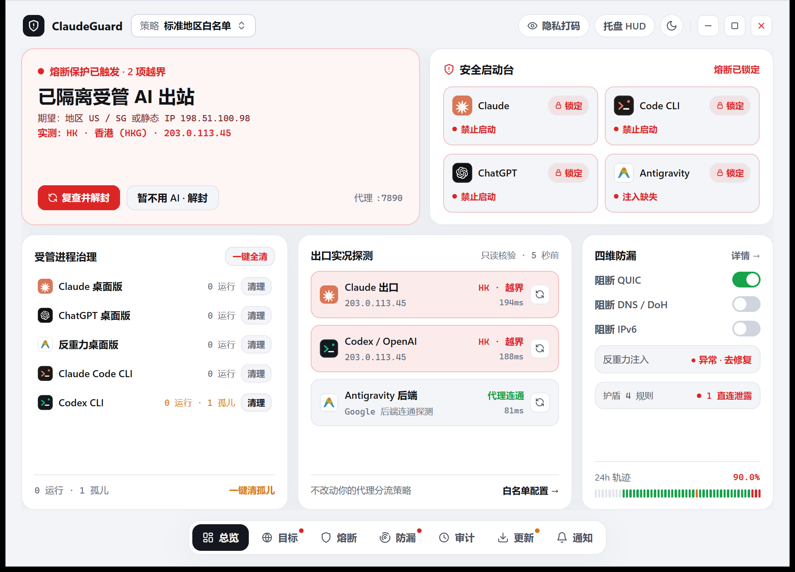
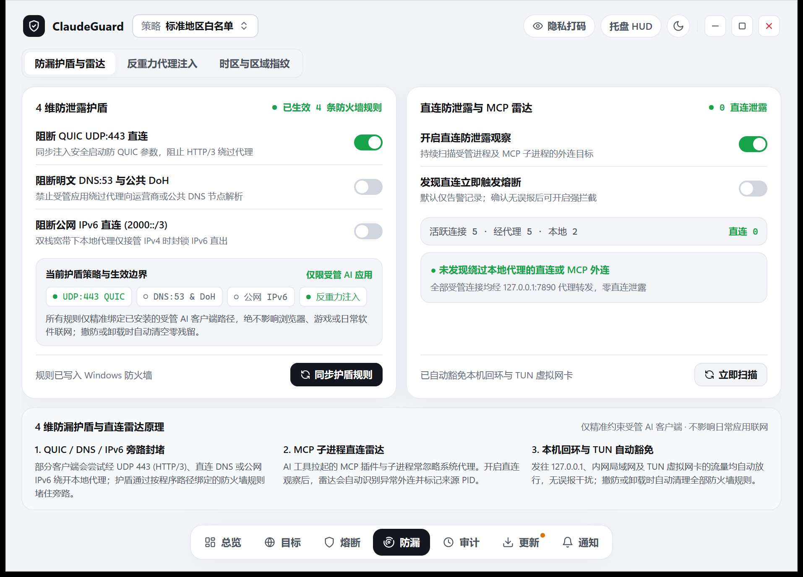
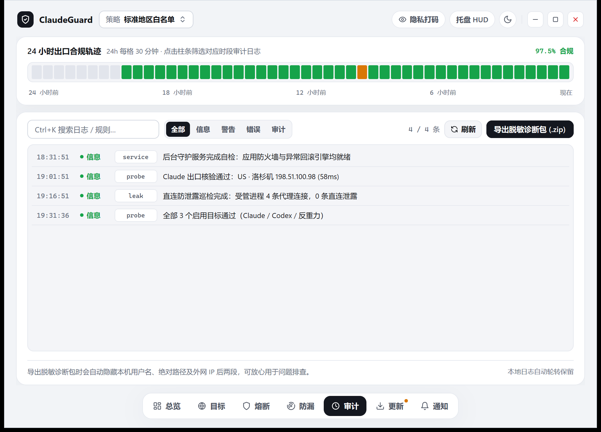
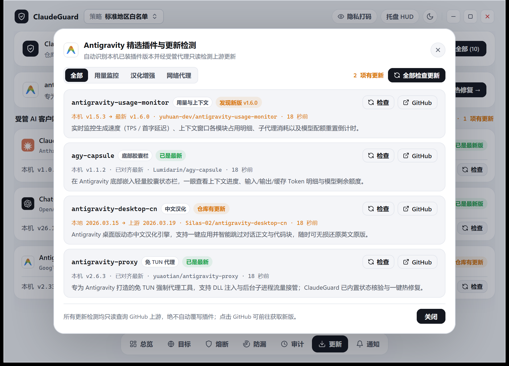

<p align="center">
  
</p>

<h1 align="center">ClaudeGuard v5（Claude 守护器）</h1>

<p align="center">
  <strong>反封号堡垒：Win32 WFP 内核防漏 + 10 维封号风险雷达 + 独立多账号金库 + &lt;2ms CLI Hook 门禁 + 原生 GPUI 桌面守护</strong>
</p>

<p align="center">
  <a href="README.md">English</a> | <a href="README.zh-CN.md">简体中文</a>
</p>

<p align="center">
  <a href="https://github.com/daha1216/ClaudeGuard/releases"></a>
  
  
  
  
  
</p>

> **架构演进说明**：在 **Windows Service 守护端（`claudeguard-daemon.exe`）+ 原生 Rust GPUI 桌面端（`claudeguard-gui.exe`）+ 命令行门禁（`claudeguard-cli.exe`）** 三端解耦、零 WebView2 依赖、日常零 UAC 弹窗与 WAL 崩溃回滚的基础上，**v5.0.0** 全面升级为 **反封号堡垒（M1–M7）**：落地 Win32 WFP 动态内核过滤、10 维风险雷达与 290+ 离线 ASN 库、独立多账号金库、4 维加密无尘室清理、`<2ms` CLI / WSL2 HMAC Hook 门禁，聚焦守护核心 AI 套件（`Claude`、`Claude Code`、`ChatGPT`、`Codex CLI`、`Antigravity`）。旧版 v3 代码完整保留在 [`v3`](https://github.com/daha1216/ClaudeGuard/tree/v3) 分支与 [`v3.12.5`](https://github.com/daha1216/ClaudeGuard/releases/tag/v3.12.5) 标签。

---

### 一句话定位

ClaudeGuard 是运行在 **Windows 10 / 11 上的 AI 工具只读出口门禁与防泄露守护系统**：按目标自己的域名**仅经你配置的本地代理只读探测**真实出口 IP、国家/地区与后端可达性（**绝不代切代理节点、绝不改写你的代理分流策略、绝不直连回退**）；全部合规才经安全启动台放行拉起桌面客户端与 CLI，一旦越界立即隔离进程与出站流量，并通过 WAL 账本在切回合规或 `--restore` 时零残留恢复。

### 为什么需要它

`Claude Desktop`、`ChatGPT / Codex`、`Antigravity IDE` 以及 `Claude Code CLI` / `Codex CLI` 对出口地区与 IP 信誉极其敏感，而代理软件常出现节点意外漂移、断代理裸连、或被 `UDP:443 QUIC`、明文 `DNS:53 / DoH`、双栈 `IPv6`、子进程（如 Antigravity 的 `language_server` 与 MCP 插件进程）悄悄绕过。

ClaudeGuard 坚持**只读观测、先拦后放**：不干涉用户的代理分流脚本，只在应用联网前后核验环境是否合规，在风险请求真正发出前先行拦截。

---

## 真实 GPUI 界面预览（Frost Ceramic 设计语言）

以下全部截图均采集自 `claudeguard-gui.exe` 真实运行窗口（Rust + Zed `gpui` 原生渲染，支持浅色 / 暗夜 / 跟随系统自适应）。

### 总览与熔断隔离态（浅色 / 暗夜 / 托盘快捷 HUD）

<table>
  <tr>
    <td align="center" width="50%">
      <br>
      <sub><strong>总览 · Frost Ceramic 浅色模式</strong> — 顶部全局策略切换、出口纯净 Hero、2×2 安全启动台、受管进程治理、只读出口实况探测与四维防漏轨迹</sub>
    </td>
    <td align="center" width="50%">
      <br>
      <sub><strong>总览 · Obsidian 暗夜模式</strong> — 跟随 Windows 深色偏好的护眼石墨配色，品牌图标暗色自适应，无刺眼白边</sub>
    </td>
  </tr>
  <tr>
    <td align="center" width="50%">
      <br>
      <sub><strong>熔断隔离锁定态</strong> — 期望与实测双行诊断直观定位越界 IP、2×2 安全启动台全锁禁拉起、越界目标标红与一键复查解封 / 暂不用 AI 解封</sub>
    </td>
    <td align="center" width="50%">
      
      <br>
      <sub><strong>模式 A · 托盘快捷 HUD（398×432）</strong> — 锚定任务栏右下角；3 目标速览、反重力注入异常换行告警、2×2 启动卡与一键全清 / 复查 / 主控制台</sub>
    </td>
  </tr>
</table>

### 目标策略、熔断防线与四维防漏护盾

<table>
  <tr>
    <td align="center" width="50%">
      <br>
      <sub><strong>目标与出口策略</strong> — 顶部三档全局策略（<code>标准地区白名单</code> / <code>严格锁定静态 IP</code> / <code>宽松防直连</code>）、CIDR 锁定、12 地区可视化多选器与自定义目标</sub>
    </td>
    <td align="center" width="50%">
      <br>
      <sub><strong>熔断策略与紧急封锁</strong> — 「仅应用级隔离 / 全局防火墙断网」两档开关、受管桌面应用勾选、手动紧急封锁与 6 项防抖/孤儿清理开关</sub>
    </td>
  </tr>
  <tr>
    <td align="center" width="50%">
      <br>
      <sub><strong>防线与进程实况</strong> — Windows 防火墙多配置文件自检，逐应用展示运行实例、孤儿进程与当前隔离规则数，一键精准清理</sub>
    </td>
    <td align="center" width="50%">
      <br>
      <sub><strong>4 维防漏护盾与 MCP 雷达</strong> — 按可执行文件路径精准写入防火墙规则封堵 <code>UDP:443 QUIC</code>、<code>DNS:53 &amp; DoH</code> 与公网 <code>IPv6</code>，并实时扫描直连与 MCP 子进程（自动豁免回环与 TUN）</sub>
    </td>
  </tr>
</table>

### 反重力注入守护、时区指纹与 24 小时合规审计

<table>
  <tr>
    <td align="center" width="50%">
      <br>
      <sub><strong>反重力代理注入守护</strong> — 深度检测 <a href="https://github.com/yuaotian/antigravity-proxy">yuaotian/antigravity-proxy</a>（<code>version.dll</code> 完整性、<code>config.json</code> 端口一致与 <code>language_server</code> 运行态挂载），更新覆盖自动拦截并支持一键热修复</sub>
    </td>
    <td align="center" width="50%">
      <br>
      <sub><strong>时区与区域指纹对齐</strong> — 仅调整 Windows 本机时区与默认定位坐标以匹配合规出口城市，绝不改动代理节点；先写 <code>env_backup.json</code> 备份，支持一键无损还原</sub>
    </td>
  </tr>
  <tr>
    <td align="center" width="50%">
      <br>
      <sub><strong>审计与 24h 合规轨迹</strong> — 48 格半小时粒度交互式时间轴点击筛选、<code>Ctrl+K</code> 全文过滤与一键导出自动脱敏（隐去用户名、本地路径与 IP 后两段）的 <code>.zip</code> 诊断包</sub>
    </td>
    <td align="center" width="50%">
      <br>
      <sub><strong>版本巡检中心（10 组件）</strong> — 全程仅经代理只读检查 ClaudeGuard、<code>antigravity-proxy</code>、Claude / Codex 桌面端与 CLI、Antigravity IDE 及 <a href="https://github.com/Silas-02/antigravity-desktop-cn">antigravity-desktop-cn</a></sub>
    </td>
  </tr>
</table>

### Antigravity 插件推荐、桌面与飞书通知

<table>
  <tr>
    <td align="center" width="50%">
      <br>
      <sub><strong>Antigravity 精选插件与更新检测</strong> — 自动识别本机已装版本并只读比对 <a href="https://github.com/yuhuan-dev/antigravity-usage-monitor">antigravity-usage-monitor</a>、<a href="https://github.com/Lumidarin/agy-capsule">agy-capsule</a>、<a href="https://github.com/Silas-02/antigravity-desktop-cn">antigravity-desktop-cn</a> 与 <a href="https://github.com/yuaotian/antigravity-proxy">antigravity-proxy</a></sub>
    </td>
    <td align="center" width="50%">
      <br>
      <sub><strong>桌面提醒与隐私脱敏</strong> — 6 类事件精细开关、一键「仅留关键告警」、默认隐藏外网 IP 与主机名，经守护端将告警中继到当前登录桌面通知中心</sub>
    </td>
  </tr>
</table>

<p align="center">
  <br>
  <sub><strong>飞书 / Lark 群机器人</strong> — HMAC-SHA256 加签校验、Windows <code>DPAPI</code> 本地加密存储、断网指数退避离线重发队列与脱敏测试发送</sub>
</p>

---

## v5 核心能力（反封号堡垒 M1–M7）

1. **M1 · Win32 WFP 动态内核防漏 + 实时阻断瀑布流**：
   - 默认启用 `AutoWfpFirst` 混合引擎（`FWPM_SESSION_DYNAMIC` 0xFF00 动态子层，守护停止时内核自动清零；可选默认关闭的 `wfp_boot_guard` 持久化开机早期过滤 `0xFF10` 与 COM 回退），并接入 `FwpmNetEventSubscribe4` 实时订阅拦截事件与脱敏瀑布流。
2. **M2 & M3 · 10 维封号风险雷达、290+ 离线 ASN 库、7 天地理速度账本与 STUN / Electron 卫生治理**：
   - 0–100（`S`–`D`）多维风险评分 + 290+ 离线 ASN 数据库 + DPAPI-HMAC-SHA256 7 天滚动地理速度账本（`egress_history.json`，磁盘零明文 IP）。
   - 内置原生 RFC 5389 STUN（UDP/WebRTC 泄露检测）及 `NtQueryInformationProcess(60)` Electron 代理参数卫生审计与 WAL 保护修复。
3. **M4 & M5 · 独立多账号金库（Sovereign Vaults）与 4 维无尘室清理器（`CGBAK005` 时光机）**：
   - 为不同账号提供独立配置目录（`--user-data-dir` / `CLAUDE_CONFIG_DIR`）、专属出口基线绑定、一键桌面 `.lnk` 启动器与默认只读硬拦截（`auto_align_mihomo_on_vault_launch: false`）。
   - 4 维残留扫描 100% 保留用户代码与配置，任何清理前强制生成 `CGBAK005`（Windows CNG AES-256-GCM + DPAPI）加密备份支持一键时光机还原。
4. **M6 & M7 · `<2ms` O(1) CLI Hook 门禁、WSL2 HMAC 桥接、`BurstGuard` 与核心 AI 套件全栈守护**：
   - `claudeguard-cli --hook-gate` 毫秒级拦截，支持 Claude Code `settings.json` 与 PowerShell `$PROFILE` 幂等自动接入、`127.0.0.1:0` WSL2 回环 HMAC-SHA256 防重放桥接以及 `BurstGuard` 高频/机械节拍防护。
   - 聚焦守护核心 **3 款桌面端**（`Claude Desktop`、`ChatGPT / Codex`、`Antigravity IDE`）+ **2 款 CLI**（`Claude Code`、`Codex CLI`），并新增原生 Win32 `RegisterHotKey` 全局热键与零 IP/用户名泄露的脱敏健康卡（Markdown + 1200×680 无元数据 PNG）。
5. **Windows Service 权限隔离 + WAL 崩溃回滚**：
   - `ClaudeGuardService`（`LocalSystem`）与普通用户权限 `claudeguard-gui.exe`（`asInvoker`）经设防 Named Pipe 通信；所有 OS 状态变更先写 WAL 再落盘，异常断电或 `--restore` 均可幂等清零防火墙与持久化 WFP 规则。

---

## 安装与快速上手（Windows 10 / 11 x64）

前往 [GitHub Releases](https://github.com/daha1216/ClaudeGuard/releases) 下载最新版：

1. **安装版 `ClaudeGuard-v5.0.0-setup.exe`（推荐）**
   - 自动注册并启动 `ClaudeGuardService` 系统服务，同时登记普通用户登录托盘自启（`claudeguard-gui.exe --tray`）。
   - **支持从 v3 / v4 无缝覆盖升级**：沿用同一 Inno Setup `AppId`，自动平滑停止旧版服务与托盘进程、清理旧版开机启动项，并在首次启动时自动将旧版 `config.json` 无损迁移至 v5（保留备份）。
   - 卸载时先调用 `claudeguard-cli.exe --restore` 清零防火墙与 WFP 规则再注销系统服务，并刻意保留 `%ProgramData%\ClaudeGuard` 与 `%APPDATA%\ClaudeGuard` 下的配置及日志。
2. **旧版客户端直升级引导 `ClaudeGuard-v5.0.0-upgrade.exe`（供 `v3.x` 客户端内直接更新）**
   - 供 `v3.x` 在 6 小时后台巡检或手动「检查更新」自动识别并下载；自动将旧版 `%APPDATA%\ClaudeGuard\config.json` 迁移至 `%ProgramData%\ClaudeGuard\config.json`，释放并等待 v5 安装器完成覆盖升级后，自动清理旧版程序、快捷方式与暂存文件。
3. **便携版 `ClaudeGuard-v5.0.0-portable.zip`**
   - 包含 `claudeguard-daemon.exe`、`claudeguard-cli.exe`、`claudeguard-gui.exe`。以管理员终端运行 `claudeguard-daemon.exe --console`（或 `--install-service --start`），再以普通用户启动 `claudeguard-gui.exe`。

> 可使用发布页提供的 `SHA256SUMS.txt` 校验安装包完整性。

---

## 命令行与启动参数

### `claudeguard-cli.exe`（亚 2ms Hook 门禁、金库启动、无尘室扫描与应急恢复）

```powershell
claudeguard-cli.exe --hook-gate --agent claude-code        # <2ms O(1) CLI 预检门禁（Claude Code JSON 或 --exit-code-block）
claudeguard-cli.exe vault launch --vault <ID> --app <APP>  # 在独立多账号金库中安全拉起受管应用
claudeguard-cli.exe --cleanroom-scan                       # 100% 只读 4 维本地无尘室残留扫描
claudeguard-cli.exe --check                                # 单次核验并输出结构化 JSON（退出码 0=通过，2=未通过）
claudeguard-cli.exe --check --recheck                      # 先触发新一轮全链路探测，再输出 JSON
claudeguard-cli.exe --restore                              # 紧急撤防并恢复全部防火墙/WFP/网络/环境（支持守护离线 WAL 回滚）
claudeguard-cli.exe --status                               # 输出守护服务、WAL 账本与当前快照状态 JSON
```

### `claudeguard-daemon.exe`（守护服务）

```powershell
claudeguard-daemon.exe --install-service --start   # 注册并启动开机自启 ClaudeGuardService
claudeguard-daemon.exe --uninstall-service         # 停止并卸载系统服务
claudeguard-daemon.exe --service-status            # 查询 Windows 服务状态 JSON
claudeguard-daemon.exe --console                   # 前台控制台调试运行
```

### `claudeguard-gui.exe`（原生 GPUI 界面）

```powershell
claudeguard-gui.exe                                # 打开完整控制台（普通用户权限）
claudeguard-gui.exe --tray                         # 静默驻留系统托盘（0 窗口、0 显存）
claudeguard-gui.exe --hud                          # 直接呼出 Mode A 托盘快捷 HUD (398x432)
claudeguard-gui.exe --demo pass                    # 零守护离线演示（pass | trip | disarmed | wizard）
```

---

## 数据存储与隐私保障

- 守护端主数据目录位于 `%ProgramData%\ClaudeGuard\`（在无写入权限或指定环境下逐级降级至 `%APPDATA%\ClaudeGuard\` → `%LOCALAPPDATA%\ClaudeGuard\`）：
  - `config.json`：v4 配置文件（兼容自动迁移 v2/v3 旧配置）。
  - `journal.json`：崩溃回滚 WAL 账本，确保异常断电/强杀后重启自动清算残留规则。
  - `feishu.json`：经 Windows `DPAPI`（`LocalMachine`）加密保存的飞书 Webhook 与加签密钥及持久队列。
  - `env_backup.json`：时区与默认定位修改前的系统原始备份。
- **默认全面脱敏**：桌面/飞书通知默认不携带外网 IP 与主机名；诊断导出 `.zip` 自动隐藏用户名、绝对路径与外网 IP 后两段；无任何第三方遥测回传。

---

## 从源码构建与测试

需安装 Rust（`1.98+`，本版基于 `rustc 1.99.0` 验证）、Windows 10/11 SDK 与 [Inno Setup 6](https://jrsoftware.org/isinfo.php)：

```powershell
# 1. 核心工作区检查与测试（333 项测试：cg-protocol / cg-core / cg-platform / cg-daemon）
cargo clippy --workspace --all-targets -- -D warnings
cargo test --workspace --locked

# 2. v3->v5 升级桥检查与测试（5 项测试：cg-v3-bridge）
cargo clippy --locked --manifest-path crates/cg-v3-bridge/Cargo.toml --all-targets -- -D warnings
cargo test --locked --manifest-path crates/cg-v3-bridge/Cargo.toml

# 3. 原生 GPUI 客户端检查与测试（71 项测试，含真实守护进程管道 E2E）
cargo clippy --locked --manifest-path crates/cg-gui/Cargo.toml --all-targets -- -D warnings
cargo test --locked --manifest-path crates/cg-gui/Cargo.toml

# 4. 打包 Release 三端程序、Inno Setup 安装包、便携版 zip 与 SHA256SUMS.txt
pwsh -NoProfile -ExecutionPolicy Bypass -File make-release.ps1
```

更多工程红线与提交流程见 [CONTRIBUTING.md](CONTRIBUTING.md)、[CHANGELOG.md](CHANGELOG.md) 与 [SECURITY.md](SECURITY.md)。

---

## 开源许可

- 核心引擎、守护服务、CLI 与 Windows 平台层（`cg-protocol`、`cg-core`、`cg-platform`、`cg-daemon`）：[MIT](LICENSE) © 2026 daha1216
- 原生 GPUI 桌面界面（`crates/cg-gui`）：Apache-2.0
